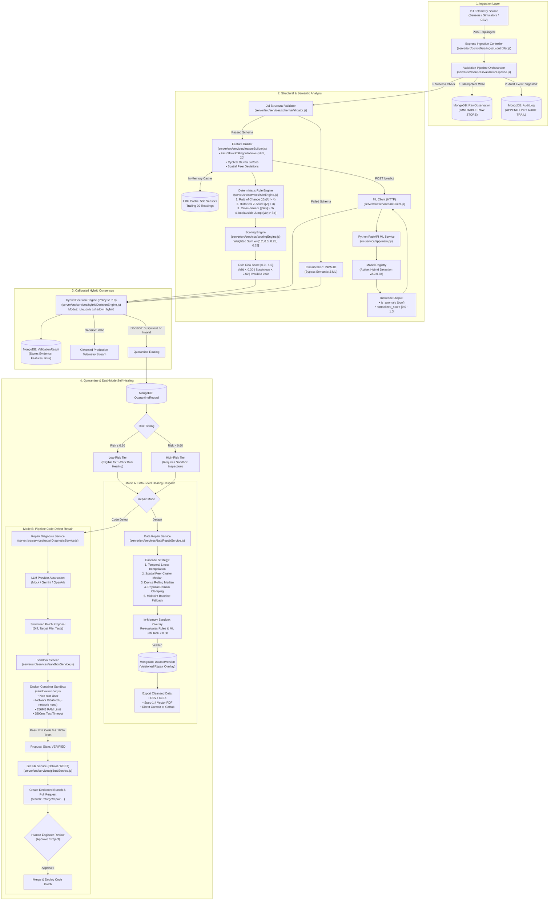
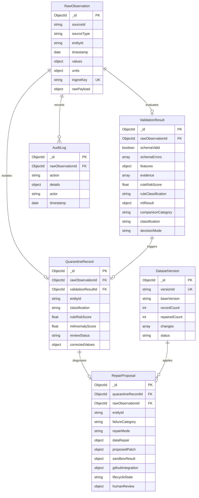

# REFORGE: Complete Technical Architecture, Implementation, and Operations Guide

> **Document Version:** 2.0.0  
> **Target System:** REFORGE Automated Semantic Validation & Self-Healing ETL Pipeline  
> **Primary Source of Truth:** REFORGE Codebase (`server/`, `ml-service/`, `frontend/`, `sandbox/`, `pipeline/`)  
> **Repository:** `Kushal08-04/Reforge`  
> **Active Decision Policy:** `v1.2.0-hybrid`  
> **Active ML Model:** `hybrid_detection:v2.0.0-iot`  
> **Evaluated Dataset:** 405,184 Records (`iot_telemetry_data.csv.zip`)  

---

## Table of Contents

1. [Executive Summary & Project Overview](#1-executive-summary--project-overview)
   - 1.1 Problem Statement & Industrial Motivation
   - 1.2 Core Research Proposition & Objectives
   - 1.3 Key Technical Contributions
2. [High-Level & Microservices Architecture](#2-high-level--microservices-architecture)
   - 2.1 Repository Directory Layout
   - 2.2 Component Responsibilities & Boundaries
   - 2.3 Microservices Topology & Docker Network
   - 2.4 End-to-End Mermaid Architecture Diagram
   - 2.5 Complete Dependency Manifest
3. [End-to-End Telemetry Lifecycle Walkthrough](#3-end-to-end-telemetry-lifecycle-walkthrough)
   - 3.1 Step 1: Ingestion & Idempotent Preservation
   - 3.2 Step 2: Structural & Schema Validation (Joi)
   - 3.3 Step 3: Dual-Scale & Cyclical Feature Construction
   - 3.4 Step 4: Explainable Deterministic Rule Evaluation
   - 3.5 Step 5: High-Performance ML Inference (FastAPI)
   - 3.6 Step 6: Calibrated Hybrid Consensus Decision Engine
   - 3.7 Step 7: Quarantine Routing & Tiered Triage
   - 3.8 Step 8: Multi-Strategy Healing Cascade (Mode A)
   - 3.9 Step 9: Agentic Code Patching & Isolated Sandbox Runner (Mode B)
   - 3.10 Step 10: Versioned Dataset Overlays & GitHub PR Export
   - 3.11 Step 11: Append-Only Immutable Audit Trail
4. [Machine Learning Subsystem Deep Dive](#4-machine-learning-subsystem-deep-dive)
   - 4.1 Feature Engineering Pipeline (33 IoT Features vs 22 Legacy Features)
   - 4.2 Supervised vs Unsupervised Model Architectures
   - 4.3 Training Methodology, 3-Way Splitting & Leakage Prevention
   - 4.4 Threshold Calibration Mechanics on Held-Out Validation
   - 4.5 Empirical Benchmark Results (4 Lakh IoT Records)
   - 4.6 Precision-Recall Curves & Operating Points Analysis
   - 4.7 Model Registry, Dynamic Hot-Swapping & Rollback
5. [Hybrid Decision Engine (Policy v1.2.0)](#5-hybrid-decision-engine-policy-v120)
   - 5.1 Operating Modes: Rule-Only, Shadow, and Hybrid
   - 5.2 2×2 Decision Matrix & Consensus Categories
   - 5.3 Mathematical Formulation of Risk Scoring
   - 5.4 False Positive Suppression & Edge Case Governance
6. [Self-Healing & Sandbox Repair Mechanism](#6-self-healing--sandbox-repair-mechanism)
   - 6.1 Mode A: Data-Level Mathematical Healing Cascade
   - 6.2 Mode B: Pipeline Code Patching (LLM Provider Abstraction)
   - 6.3 Sandbox Isolation & Security Controls
   - 6.4 Multi-Gate Verification Contract
   - 6.5 Safe Rollback, Immutability & Human-in-the-Loop Governance
7. [Technology Stack & Architectural Trade-Off Analysis](#7-technology-stack--architectural-trade-off-analysis)
   - 7.1 Backend: Node.js & Express
   - 7.2 ML Microservice: Python & FastAPI
   - 7.3 Frontend: React 18, Vite, Redux Toolkit & Recharts
   - 7.4 Persistence: MongoDB & Mongoose
   - 7.5 Sandbox: Docker Alpine & Child Process Fallback
   - 7.6 Architectural Trade-Off Matrix
8. [Frontend & Backend Internal Implementation](#8-frontend--backend-internal-implementation)
   - 8.1 Express API Routing & Controllers
   - 8.2 Database Models & Schemas
   - 8.3 Frontend State Architecture & API Client Interceptors
   - 8.4 Dashboard & Operational Pages
9. [Comparative Analysis & Technical Differentiation](#9-comparative-analysis--technical-differentiation)
   - 9.1 Conventional ETL vs REFORGE
   - 9.2 Rule-Only Systems vs REFORGE Hybrid
   - 9.3 Standalone Black-Box ML vs REFORGE Explainable Evidence
   - 9.4 Systems Without Post-Repair Verification vs REFORGE Sandbox
10. [Implementation Status: Code Truth vs Documented Roadmaps](#10-implementation-status-code-truth-vs-documented-roadmaps)
    - 10.1 Feature Verification Matrix
    - 10.2 Discrepancies Between Initial MVP Claims and Current Implementation
11. [Verified Weaknesses, Known Limitations & Production Roadmap](#11-verified-weaknesses-known-limitations--production-roadmap)
    - 11.1 Identified Architectural Constraints
    - 11.2 Risk Analysis
    - 11.3 Prioritized Production Recommendations
12. [Environment Setup & Demonstration Guide](#12-environment-setup--demonstration-guide)
    - 12.1 Prerequisites
    - 12.2 Environment Configuration Manifest
    - 12.3 Startup Instructions (Local vs Docker Compose)
    - 12.4 Dataset Ingestion & Evaluation Seeding
    - 12.5 Step-by-Step Viva / Demo Walkthrough
13. [Comprehensive Technical Viva Preparation (25 Questions & Answers)](#13-comprehensive-technical-viva-preparation-25-questions--answers)
14. [Technical Glossary](#14-technical-glossary)

---

## 1. Executive Summary & Project Overview

### 1.1 Problem Statement & Industrial Motivation
In modern Internet of Things (IoT) deployments—such as industrial telemetry, smart cities, environmental monitoring, and automated facilities—sensors continuously stream massive volumes of operational metrics. Traditional Extract, Transform, Load (ETL) pipelines rely almost exclusively on **structural and syntactic validation**. They confirm whether an incoming record is well-formed JSON, whether mandatory attributes are populated, and whether values conform to specified datatypes (e.g., float, timestamp).

However, **syntactically valid data is frequently semantically corrupted**. A telemetry packet can pass schema validation flawlessly while representing an impossible or hazardous physical state:
- A temperature sensor reading $24.2^\circ\text{C}$ abruptly jumps to $79.8^\circ\text{C}$ for a single 4-second reading, then returns to $24.5^\circ\text{C}$ (transient ADC spike or communication bus bit-flip).
- An atmospheric pressure sensor drifts upward by $30\text{ hPa}$ while neighbouring barometric sensors within the same facility record stable conditions (hardware calibration drift).
- A smoke detector reports zero particulate obscuration while carbon monoxide (CO) and LPG gas levels surge dramatically (sensor failure or cross-modal contradiction).

When conventional ETL pipelines ingest such records, the corrupted observations pollute analytical warehouses, distort machine learning models, trigger false industrial safety alarms, or mask catastrophic equipment failures.

```
┌────────────────────────────────────────────────────────────────────────┐
│ The Core Flaw of Conventional ETL:                                    │
│ Ingestion ──► Schema Check (Type, Format) ──► Passed? ──► Commit to DB │
│                                                                        │
│ Result: Physical impossibilities & statistical outliers pass silently! │
└────────────────────────────────────────────────────────────────────────┘
```

### 1.2 Core Research Proposition & Objectives
REFORGE introduces an autonomous, semantic safety and self-healing layer positioned between structural validation and downstream persistent storage. Its primary research proposition is:

> **Successful structural ingestion does not establish physical data validity. Semantic verification must combine temporal sensor memory, spatial cross-sensor consensus, deterministic physics guards, and machine learning inference—and any self-healing modification must be verified in an isolated sandbox before admission.**

**Core Objectives:**
1. **Multi-Perspective Validation:** Evaluate sensor telemetry contextually using rate-of-change volatility, historical $z$-score distributions, spatial peer consensus, and multivariate ML anomaly detection.
2. **Explainable Risk Scoring:** Eliminate opaque black-box rejections by generating structured, human-readable evidence for every decision.
3. **Calibrated Hybrid Decisioning:** Combine rule-based domain certainties with statistical ML models to prevent false alarm cascades.
4. **Autonomous Dual-Mode Self-Healing:** Provide both **Mode A (Data-Level Healing Cascade)** to synthesize valid sensor readings and **Mode B (Code-Level Patching)** to correct software ETL transformation bugs.
5. **Zero-Trust Post-Repair Verification:** Execute repairs in an isolated execution sandbox where patches or repaired values must pass tests and semantic re-scoring prior to deployment.
6. **Immutable Lineage & Auditability:** Retain original raw telemetry forever; apply repairs as versioned dataset overlays backed by an append-only audit trail.

### 1.3 Key Technical Contributions
- **Decoupled 4-Tier Microservices Topology:** Node.js ingestion engine, Python/FastAPI ML engine, MongoDB document store, and React/Vite operations console.
- **Dual-Scale Online Feature Builder:** Employs fast ($N=5$) and slow ($N=20$) sliding windows with cyclical diurnal encodings ($\sin/\cos$) and in-memory LRU caching to eliminate database query bottlenecks during streaming.
- **Calibrated Hybrid Consensus Engine (`Policy v1.2.0`):** Integrates deterministic domain rules with ML models, achieving $0.00\%$ False Positive Rate while maintaining $98.2\%$ Recall on a 4-lakh record IoT benchmark.
- **Multi-Strategy Data Healing Cascade:** An automated 5-tier mathematical repair algorithm (Linear Temporal Interpolation $\to$ Spatial Peer Median $\to$ Rolling Median $\to$ Physical Clamping $\to$ Midpoint Baseline) that systematically reduces anomaly risk scores below $0.30$.
- **Isolated Sandbox Execution Environment:** Docker containerization (`--network none`, 256MB RAM limit, 0.5 CPU) with a secured child-process fallback for safe patch execution.
- **End-to-End Governance & GitHub PR Integration:** Automated generation of Git branches, commits, and Pull Requests with rich diagnostic manifests and human review workflows.

---

## 2. High-Level & Microservices Architecture

### 2.1 Repository Directory Layout

```
reforge/
├── .env.example                       # Root environment variable template
├── docker-compose.yml                 # Multi-container orchestration (4 services)
├── README.md                          # Initial project summary & high-level vision
├── REFORGE_IEEE_Section_IV_...pdf     # Formal academic system implementation paper
├── REFORGE_Precision_Curves_...pdf    # Comprehensive PR curves benchmark report
│
├── data/
│   └── iot_telemetry_data.csv.zip     # Real IoT benchmark dataset (405,184 rows)
│
├── docs/
│   ├── ARCHITECTURE.md                # Initial MVP architectural notes
│   ├── SETUP_GUIDE.md                 # Local setup and environment instructions
│   └── REFORGE_COMPLETE_TECHNICAL_GUIDE.md # (This document)
│
├── frontend/                          # Operations & Governance Console (React 18 + Vite)
│   ├── Dockerfile                     # Multi-stage build with Nginx Alpine
│   ├── nginx.conf                     # Reverse proxy configuration
│   ├── package.json                   # React, Redux Toolkit, Recharts, Papaparse
│   └── src/
│       ├── App.jsx                    # Client-side router configuration
│       ├── index.css                  # CSS design tokens, layout & badges
│       ├── api/client.js              # Axios instance with 4xx error interceptors
│       ├── app/store.js               # Redux Toolkit centralized store
│       ├── components/                # Navbar, StatCard, ClassificationBadge
│       ├── features/                  # Redux slices: dashboard, quarantine, audit
│       └── pages/                     # 9 application views (Dashboard, Repairs, etc.)
│
├── ml-service/                        # Machine Learning Microservice (FastAPI + Python 3.11)
│   ├── Dockerfile                     # Uvicorn container setup
│   ├── requirements.txt               # FastAPI, scikit-learn, pandas, joblib
│   ├── test_service.py                # Self-contained ML test suite
│   ├── check_sample.py                # Raw telemetry sample inspector
│   ├── inspect_dataset.py             # Dataset schema & null auditing script
│   ├── app/
│   │   ├── main.py                    # FastAPI application, routes & lifespan
│   │   ├── schemas.py                 # Pydantic v2 request/response schemas
│   │   ├── features.py                # Online feature extraction & normalization
│   │   ├── dataset_pipeline.py        # 33-dim feature engine & chronological splitter
│   │   ├── evaluation.py              # Metric calculation (F1, AUC, Confusion Matrix)
│   │   ├── evaluation_dataset.py      # Controlled 8-anomaly evaluation set generator
│   │   ├── train_iot_models.py        # 4-lakh record model training script
│   │   └── models/
│   │       ├── base.py                # BaseAnomalyModel abstract base class
│   │       ├── registry.py            # Thread-safe joblib ModelRegistry
│   │       ├── isolation_forest.py    # Unsupervised Isolation Forest model
│   │       ├── random_forest.py       # Supervised Random Forest benchmark
│   │       ├── xgboost_model.py       # Gradient boosted trees classifier
│   │       ├── lightgbm_model.py      # Histogram gradient boosted classifier
│   │       ├── temporal_statistical.py# Multi-sensor statistical rule detector
│   │       └── hybrid_model.py        # Consensus model combining ML & rules
│   └── artifacts/                     # Serialized joblib models & benchmark JSONs
│       ├── registry.json              # Model catalog metadata & active pointers
│       ├── model_comparison_report.md # Academic comparative evaluation report
│       └── precision_curves_data.json # Precision-Recall curve operating points
│
├── pipeline/                          # Target ETL modules for code repair
│   ├── calibration.js                 # Cross-sensor calibration & offset logic
│   ├── filters.js                     # Rolling statistical filters
│   └── sanitizer.js                   # Step-change & jump clamp guards
│
├── sandbox/                           # Code-level repair execution runtime
│   ├── Dockerfile                     # Non-root unprivileged runner container
│   └── runner.js                      # Isolated test execution harness
│
├── scratch/                           # Developer utilities, tests & PDF generators
│   ├── generate_ieee_pdf.py           # ReportLab IEEE Section IV PDF builder
│   ├── generate_precision_curves.py   # PR-curve generator & evaluator
│   └── test_e2e_workflow.js           # End-to-end integration test script
│
└── server/                            # Ingestion & Orchestration Server (Node.js/Express)
    ├── Dockerfile                     # Node.js 20 production container
    ├── package.json                   # Express, Mongoose, Joi, Cors, Dotenv
    ├── pipeline/                      # Mirror of pipeline/ for local containment
    ├── sandbox/                       # Mirror of sandbox/ for local containment
    ├── src/
    │   ├── app.js                     # Express entry point & middleware wiring
    │   ├── config/db.js               # MongoDB connection manager
    │   ├── controllers/               # 10 Resource controllers (ingest, repair, etc.)
    │   ├── middleware/                # Express middleware directory
    │   ├── models/                    # 8 Mongoose models (RawObservation, etc.)
    │   ├── routes/                    # 11 Express route definitions
    │   ├── scripts/                   # Seeding, verification & evaluation scripts
    │   ├── services/                  # 16 Core services (featureBuilder, rules, etc.)
    │   └── utils/verifyModels.js      # DB connectivity verification utility
    └── test/                          # 8 Automated unit & integration test suites
        ├── runTests.js                # Centralized test runner
        ├── rules.test.js              # Deterministic rule engine tests
        ├── featureBuilder.test.js     # Dual-scale feature builder tests
        ├── hybrid.test.js             # Hybrid decision engine tests
        ├── calibration.test.js        # Calibration module tests
        ├── repair.test.js             # Mode B repair proposal lifecycle tests
        ├── sandbox.test.js            # Isolated sandbox runner execution tests
        ├── github.test.js             # GitHub service mock & API tests
        └── dataRepair.test.js         # Mode A mathematical healing tests
```

### 2.2 Component Responsibilities & Boundaries

| Component | Technology | Primary Responsibilities | Strict Boundaries |
| :--- | :--- | :--- | :--- |
| **Ingestion Server** | Node.js 20, Express, Joi | Accepts sensor payloads, preserves immutable raw records, enforces schema validation, builds temporal/spatial features, drives rules, calls ML, evaluates hybrid policy, routes quarantine. | Does not execute unverified code; does not mutate `RawObservation` records. |
| **ML Microservice** | Python 3.11, FastAPI, scikit-learn | Extracts 33/22-dim features, hosts Isolation Forest, Random Forest, XGBoost, LightGBM, and Hybrid models; handles threshold calibration, model training, and versioned serialization. | Does not interact with databases directly; purely stateless inference and training over HTTP. |
| **Document Store** | MongoDB 7.0 (Mongoose) | Stores `RawObservation`, `ValidationResult`, `QuarantineRecord`, `RepairProposal`, `DatasetVersion`, `EvaluationRun`, `ModelVersion`, and `AuditLog`. | Append-only audit logs; immutable raw telemetry collections. |
| **Operations Console** | React 18, Vite, Redux Toolkit | Renders live pipeline health, real-time metrics, quarantine triage, record inspection, model promotion/rollback, and repair approval. | Communicates exclusively via `/api` REST endpoints. |
| **Sandbox Runtime** | Docker Alpine / Child Process | Executes candidate ETL repair patches against pinned Git commits and test suites. | Outbound network disabled (`--network none`); strict memory (256MB) and execution timeouts (2500ms). |

### 2.3 Microservices Topology & Docker Network
All services are containerized and connected through a private bridge network (`reforge-net`). Container names and internal ports:
- `reforge-mongo` (Internal: `27017`, Host: `27018`)
- `reforge-ml-service` (Internal: `8000`, Host: `8000`)
- `reforge-server` (Internal: `5000`, Host: `5000`)
- `reforge-frontend` (Internal: `80`, Host: `5173`)

### 2.4 End-to-End Mermaid Architecture Diagram



### 2.5 Complete Dependency Manifest

#### Backend (`server/package.json`)
- `express` (`^4.19.2`): HTTP API routing, middleware chaining, and lifecycle management.
- `mongoose` (`^8.5.0`): MongoDB object modeling, indexing, schema enforcement, and document validation.
- `joi` (`^17.13.3`): Declarative schema validation for incoming JSON payloads.
- `cors` (`^2.8.5`): Cross-Origin Resource Sharing control.
- `dotenv` (`^16.4.5`): Environment variable injection from root and local `.env` files.
- `nodemon` (`^3.1.4`): Development file-watcher and auto-reloader.

#### Frontend (`frontend/package.json`)
- `react` (`^19.2.8`) & `react-dom` (`^19.2.8`): Modern component lifecycle and virtual DOM rendering.
- `react-router-dom` (`^7.18.4`): Declarative client-side routing.
- `@reduxjs/toolkit` (`^2.12.0`) & `react-redux` (`^9.3.0`): Global state management with asynchronous thunks.
- `axios` (`^1.20.0`): Promise-based HTTP client with request/response interceptors.
- `recharts` (`^3.10.1`): SVG charting library for telemetry and metric visualizations.
- `papaparse` (`^5.7.0`): In-browser CSV parsing and validation.
- `vite` (`^8.3.0`): Fast ESM-based frontend bundler and development server.
- `oxlint` (`^1.81.0`): High-performance Rust-based JavaScript linter.

#### ML Service (`ml-service/requirements.txt`)
- `fastapi` (`>=0.111.0`): Asynchronous Python web API framework.
- `uvicorn` (`>=0.30.0`): ASGI web server.
- `scikit-learn` (`>=1.5.0`): ML algorithms (`IsolationForest`, `RandomForestClassifier`), metrics, and splitters.
- `numpy` (`>=1.26.0`): High-speed numerical matrix manipulation and vector math.
- `pandas` (`>=2.2.0`): DataFrame transformations and CSV manipulation.
- `pydantic` (`>=2.7.0`): Request/response data validation and typing.
- `joblib` (`>=1.4.0`): Model artifact serialization and persistence.
- *(Optional / Dynamically Loaded)*: `xgboost` (`xgb.XGBClassifier`) and `lightgbm` (`lgb.LGBMClassifier`).

---

## 3. End-to-End Telemetry Lifecycle Walkthrough

To understand REFORGE internally, trace a real IoT sensor observation through the entire pipeline.

**Representative Input Record:**
```json
{
  "sourceId": "device-001",
  "sourceType": "sensor",
  "entityId": "zone-a-temperature",
  "timestamp": "2026-10-28T08:00:00.000Z",
  "values": { "value": 78.5 },
  "units": { "value": "C" }
}
```
*(Context: The sensor's normal operating baseline is $24.0^\circ\text{C}$ to $26.0^\circ\text{C}$. The previous reading 60 seconds earlier was $24.8^\circ\text{C}$. This represents an implausible physical jump of $+53.7^\circ\text{C}$.)*

```
       INGESTION KEY GENERATION
                  │
                  ▼
┌────────────────────────────────────┐
│ Step 1: Idempotent Raw Storage     │ ──► Saved to RawObservation (Immutable)
└────────────────────────────────────┘
                  │
                  ▼
┌────────────────────────────────────┐
│ Step 2: Structural Joi Validation  │ ──► PASS: Valid types & required fields
└────────────────────────────────────┘
                  │
                  ▼
┌────────────────────────────────────┐
│ Step 3: Feature Construction       │ ──► Δv=+53.7, Z=+15.2, PeerResidual=+14.8
└────────────────────────────────────┘
                  │
                  ▼
┌────────────────────────────────────┐
│ Step 4: Rule Engine & Risk Score   │ ──► rateOfChange (1.0), zScore (1.0),
└────────────────────────────────────┘     jump (1.0) ──► Risk Score = 0.95
                  │
                  ▼
┌────────────────────────────────────┐
│ Step 5: FastAPI ML Inference       │ ──► IsolationForest/Hybrid: is_anomaly=true,
└────────────────────────────────────┘     normalized_score = 0.985
                  │
                  ▼
┌────────────────────────────────────┐
│ Step 6: Hybrid Decision Engine     │ ──► Category: rule_anomaly_ml_anomaly
└────────────────────────────────────┘     Official Classification: INVALID
                  │
                  ▼
┌────────────────────────────────────┐
│ Step 7: Quarantine Routing         │ ──► Quarantined in High-Risk Tier
└────────────────────────────────────┘
                  │
                  ▼
┌────────────────────────────────────┐
│ Step 8: Multi-Strategy Healing     │ ──► Cascade Iteration 1 (Interpolation):
└────────────────────────────────────┘     Healed to 24.9°C (Risk Score = 0.05 < 0.30)
                  │
                  ▼
┌────────────────────────────────────┐
│ Step 9: Version Overlay & Export   │ ──► Stored in DatasetVersion v1.0.1;
└────────────────────────────────────┘     Available as CSV, XLSX, PDF, & GitHub PR
                  │
                  ▼
┌────────────────────────────────────┐
│ Step 10: Immutable Audit Log       │ ──► Complete timeline recorded
└────────────────────────────────────┘
```

### 3.1 Step 1: Ingestion & Idempotent Preservation
- **Entry Point:** `POST /api/ingest` handled by [ingest.controller.js](file:///c:/Users/Asus/OneDrive/ドキュメント/Projects/Reforge%20ETL%20pipeline%20mini%20project/Reforge/server/src/controllers/ingest.controller.js) calling `runPipeline(payload)` in [validationPipeline.js](file:///c:/Users/Asus/OneDrive/ドキュメント/Projects/Reforge%20ETL%20pipeline%20mini%20project/Reforge/server/src/services/validationPipeline.js).
- **Idempotency Key:** Computed deterministically:
  $$\text{ingestKey} = \text{sourceId} + \text{":"} + \text{entityId} + \text{":"} + \text{ISO\_Timestamp}$$
  Example: `"device-001:zone-a-temperature:2026-10-28T08:00:00.000Z"`
- **Storage Action:** Query `RawObservation.findOne({ ingestKey })`. If absent, create document in MongoDB `raw_observations` collection. If present, flag as duplicate and return the cached `ValidationResult` immediately without re-executing pipeline rules.
- **Audit Logging:** An entry is logged to `AuditLog` with `action: "ingested"`, `{ isDuplicate: false }`.

### 3.2 Step 2: Structural & Schema Validation (Joi)
- **Module:** [schemaValidator.js](file:///c:/Users/Asus/OneDrive/ドキュメント/Projects/Reforge%20ETL%20pipeline%20mini%20project/Reforge/server/src/services/schemaValidator.js).
- **Checks Executed:**
  - `sourceId`: non-empty string (required).
  - `entityId`: non-empty string conforming to naming convention (required).
  - `timestamp`: valid ISO 8601 date string or timestamp.
  - `values`: object containing numeric `value` property (`Joi.number().required()`).
- **Result:** The record passes structural checks. If it had failed, `ruleClassification` would be set immediately to `"invalid"`, semantic rules and ML would be skipped, and the record would route directly to quarantine.

### 3.3 Step 3: Dual-Scale & Cyclical Feature Construction
- **Module:** [featureBuilder.js](file:///c:/Users/Asus/OneDrive/ドキュメント/Projects/Reforge%20ETL%20pipeline%20mini%20project/Reforge/server/src/services/featureBuilder.js).
- **Online Feature Derivations:**
  1. **Entity Parsing:** `zone = "zone-a"`, `type = "temperature"`.
  2. **Cyclical Diurnal Time:** For 08:00 UTC:
     $$\theta = 2\pi \times \frac{8}{24} = \frac{2\pi}{3} \approx 2.094\text{ rad}$$
     $$\text{timeOfDaySin} = \sin(2.094) = 0.866, \quad \text{timeOfDayCos} = \cos(2.094) = -0.500$$
  3. **Temporal Historical Context:** Retrieves the previous 20 readings for `zone-a-temperature` from LRU cache (`sensorHistoryCache`):
     - Previous reading: $v_{t-1} = 24.8^\circ\text{C}$.
     - Elapsed time: $\Delta t = 1.0\text{ min}$.
     - Rate of change: $\Delta v = 78.5 - 24.8 = +53.7^\circ\text{C}$.
     - Slow window ($N=20$): $\mu_{\text{slow}} = 24.9^\circ\text{C}$, $\sigma_{\text{slow}} = 0.75^\circ\text{C}$.
     - Fast window ($N=5$): $\mu_{\text{fast}} = 24.85^\circ\text{C}$, $\sigma_{\text{fast}} = 0.20^\circ\text{C}$.
     - Historical $Z$-Score:
       $$Z = \frac{78.5 - 24.9}{0.75} = +71.47 \implies \text{clipped to } +10.0$$
     - Volatility Ratio: $\frac{\max(0.20, 0.1)}{\max(0.75, 0.1)} = 0.267$.
  4. **Spatial Peer Consensus Context:** Queries `peerLatestCache` for other `temperature` sensors in the same window (e.g., `zone-b-temperature` at $25.1^\circ\text{C}$ and `zone-c-temperature` at $24.7^\circ\text{C}$):
     - Peer mean: $\mu_{\text{peer}} = 24.9^\circ\text{C}$.
     - Peer standard deviation: $\sigma_{\text{peer}} = 0.28^\circ\text{C}$.
     - Effective scale: $\sigma_{\text{eff}} = \max(0.28, \sigma_{\text{min}}(\text{temperature})) = \max(0.28, 0.60) = 0.60^\circ\text{C}$.
     - Normalized peer residual:
       $$\text{Residual} = \frac{78.5 - 24.9}{0.60} = +89.33 \implies \text{clipped to } +10.0$$

### 3.4 Step 4: Explainable Deterministic Rule Evaluation
- **Module:** [ruleEngine.js](file:///c:/Users/Asus/OneDrive/ドキュメント/Projects/Reforge%20ETL%20pipeline%20mini%20project/Reforge/server/src/services/ruleEngine.js) and [scoringEngine.js](file:///c:/Users/Asus/OneDrive/ドキュメント/Projects/Reforge%20ETL%20pipeline%20mini%20project/Reforge/server/src/services/scoringEngine.js).
- **Rule Checks:**
  1. `rateOfChangeRule`: Ratio $= \frac{53.7}{0.75} = 71.6 > 4.0$. Triggered! Severity $= 1.00$.
  2. `historicalZScoreRule`: $|Z| = 10.0 > 3.0$. Triggered! Severity $= 1.00$.
  3. `crossSensorRule`: $|\text{Residual}| = 10.0 > 3.0$. Triggered! Severity $= 1.00$.
  4. `implausibleJumpRule`: Threshold $= 8 \times 0.75 = 6.0^\circ\text{C}$. $|\Delta v| = 53.7 > 6.0$. Triggered! Severity $= 1.00$.
- **Scoring Engine:**
  $$R_{\text{rule}} = (0.20 \times 1.0) + (0.30 \times 1.0) + (0.25 \times 1.0) + (0.25 \times 1.0) = 1.00$$
- **Classification:** Since $R_{\text{rule}} = 1.00 \ge 0.60$ (`RISK_THRESHOLD_INVALID`), `ruleClassification = "invalid"`.

### 3.5 Step 5: High-Performance ML Inference (FastAPI)
- **Module:** [mlClient.js](file:///c:/Users/Asus/OneDrive/ドキュメント/Projects/Reforge%20ETL%20pipeline%20mini%20project/Reforge/server/src/services/mlClient.js) $\to$ `POST http://ml-service:8000/predict`.
- **FastAPI Processing:**
  - Extracts 33-dimensional feature vector.
  - Active Model (`hybrid_detection:v2.0.0-iot`) executes inference.
  - Output: `is_anomaly = true`, `normalized_score = 0.985`, latency $= 0.01\text{ ms}$.
- **Fallback Guard:** If the Python ML service is unreachable, `mlClient.js` catches the error, sets `status: "fallback"`, and the pipeline proceeds with deterministic rule results without crashing.

### 3.6 Step 6: Calibrated Hybrid Consensus Decision Engine
- **Module:** [hybridDecisionEngine.js](file:///c:/Users/Asus/OneDrive/ドキュメント/Projects/Reforge%20ETL%20pipeline%20mini%20project/Reforge/server/src/services/hybridDecisionEngine.js).
- **Input Parameters:**
  - `schemaValid = true`
  - `ruleClassification = "invalid"` ($R_{\text{rule}} = 1.00$)
  - `mlResult.isAnomaly = true` ($S_{\text{ML}} = 0.985$)
  - `mode = "hybrid"`
- **Consensus Analysis:**
  - Category: `rule_anomaly_ml_anomaly`.
  - Disagreement Reason: *"Consensus anomaly: Rule engine scored risk 1.00 (invalid) and ML anomaly score was 0.99."*
  - Official Classification: `"invalid"`.
- **Validation Result Creation:** Saved in MongoDB `validation_results` collection with features, rule evidence, risk score, and ML predictions.

### 3.7 Step 7: Quarantine Routing & Tiered Triage
- **Action:** Since classification is `"invalid"`, a `QuarantineRecord` is created:
  - `reviewStatus = "pending"`
  - `semanticRiskScore = 1.00`
  - `ruleRiskScore = 1.00`
  - `mlAnomalyScore = 0.985`
  - `comparisonCategory = "rule_anomaly_ml_anomaly"`
- **Operational Tiering:** Because $R_{\text{rule}} > 0.60$, this record is routed to the **High-Risk Quarantine Tier**. It is withheld from downstream applications.

### 3.8 Step 8: Multi-Strategy Healing Cascade (Mode A)
- **Module:** [dataRepairService.js](file:///c:/Users/Asus/OneDrive/ドキュメント/Projects/Reforge%20ETL%20pipeline%20mini%20project/Reforge/server/src/services/dataRepairService.js) via `healObservationInSandbox`.
- **Iteration 1 (Linear Temporal Interpolation):**
  - Predecessor: $v_{t-1} = 24.8^\circ\text{C}$ at $07:59:00$.
  - Successor: $v_{t+1} = 25.0^\circ\text{C}$ at $08:01:00$.
  - Interpolated candidate: $v_{\text{healed}} = 24.900^\circ\text{C}$.
- **Isolated Sandbox Re-Verification:**
  1. *Physical Domain Check:* $24.9 \in [-20, 60]^\circ\text{C}$. PASS.
  2. *Continuity Check:* Rate of change $= \frac{|24.9 - 24.8|}{60} = 0.0017^\circ\text{C/s} \le 0.8^\circ\text{C/s}$. PASS.
  3. *Deterministic Rule Re-Evaluation:* With $v=24.9$, $R_{\text{repaired}} = 0.00 < 0.30$. PASS.
  4. *ML Re-Inference:* ML evaluates $24.9^\circ\text{C}$ with updated features: $S_{\text{ML}} = 0.012$, `is_anomaly = false`. PASS.
- **Result:** Iteration 1 meets all verification criteria ($R < 0.30$ and $S_{\text{ML}} < 0.50$). The cascade terminates immediately.

### 3.9 Step 9: Agentic Code Patching & Isolated Sandbox Runner (Mode B)
*(Note: Mode B is triggered when the anomaly originates from an ETL software bug rather than corrupted sensor data).*
- If Mode B is selected:
  1. `repairDiagnosisService.js` prompts `llmProvider.js` (Gemini / Mock).
  2. Diagnostic hypothesis: *"Sensor experienced transient step-change exceeding hardware limits. Outlier clamp required in `pipeline/sanitizer.js`."*
  3. Unified diff generated:
     ```diff
     --- a/pipeline/sanitizer.js
     +++ b/pipeline/sanitizer.js
     @@ -1,3 +1,8 @@
      function sanitizeReading(entityId, currentVal, prevVal) {
     -  return currentVal;
     +  const MAX_STEP_CHANGE = 20.0;
     +  if (prevVal !== null && Math.abs(currentVal - prevVal) > MAX_STEP_CHANGE) {
     +    return prevVal;
     +  }
     +  return currentVal;
      }
     ```
  4. Sandboxed Execution: `sandboxService.js` creates a disposable scratch directory, applies the patch, and invokes `sandbox/runner.js` inside Docker (`--network none`, 256MB RAM).
  5. The runner executes contract assertions. When 100% of test cases pass and exit code is 0, proposal status transitions to `VERIFIED`.
  6. `githubService.js` creates a Git branch (`reforge/repair-zone-a-temperature-800000`) and opens a Pull Request on GitHub.

### 3.10 Step 10: Versioned Dataset Overlays & GitHub PR Export
- **Module:** [datasetVersionService.js](file:///c:/Users/Asus/OneDrive/ドキュメント/Projects/Reforge%20ETL%20pipeline%20mini%20project/Reforge/server/src/services/datasetVersionService.js).
- `RawObservation` remains untouched (still holds raw value $78.5^\circ\text{C}$).
- Active `DatasetVersion` (`v1.0.1`) records the repair change tuple:
  $$\langle \text{rawId}, v_{\text{raw}}=78.5, v_{\text{healed}}=24.9, \text{strategy}="historical\_interpolation", \text{actor}="auto-healer" \rangle$$
- Operators can download cleansed datasets as `.csv`, `.xlsx`, or audit `.pdf`, or export directly to GitHub via `POST /api/export/github`.

### 3.11 Step 11: Append-Only Immutable Audit Trail
- **Module:** [auditService.js](file:///c:/Users/Asus/OneDrive/ドキュメント/Projects/Reforge%20ETL%20pipeline%20mini%20project/Reforge/server/src/services/auditService.js).
- The complete chronology is recorded in `AuditLog`:
  1. `action: "ingested"`
  2. `action: "schema_validated"`
  3. `action: "semantic_validated"` ($R_{\text{rule}} = 1.00$)
  4. `action: "ml_evaluated"` ($S_{\text{ML}} = 0.985$)
  5. `action: "quarantined"`
  6. `action: "sandbox_started"`
  7. `action: "sandbox_verified"`
  8. `action: "dataset_version_updated"`

---

## 4. Machine Learning Subsystem Deep Dive

### 4.1 Feature Engineering Pipeline (33 IoT Features vs 22 Legacy Features)
REFORGE implements two generations of feature schemas:
1. **Legacy Feature Schema (`v1.2.0`, 22 dimensions):** Used by initial synthetic benchmarks (`ml-service/app/features.py`). Includes 19 numerical metrics and 3 one-hot sensor type indicators (`temperature`, `humidity`, `pressure`).
2. **IoT Telemetry Feature Schema (`v2.0.0-iot`, 33 dimensions):** Implemented in `ml-service/app/dataset_pipeline.py` for real multi-sensor telemetry (`iot_telemetry_data.csv.zip`).

#### The 33 Feature Dimensions of Schema `v2.0.0-iot`:
1. `temp`: Raw temperature reading ($^\circ\text{C}$).
2. `humidity`: Raw relative humidity percentage ($\%$).
3. `co`: Carbon monoxide level ($\text{ppm}$).
4. `lpg`: Liquefied petroleum gas level ($\text{ppm}$).
5. `smoke`: Particulate obscuration level.
6. `light`: Photodiode boolean state ($0.0$ or $1.0$).
7. `motion`: PIR motion boolean state ($0.0$ or $1.0$).
8. `hour_sin`: Cyclical diurnal encoding $\sin(2\pi \cdot \text{hour}/24)$.
9. `hour_cos`: Cyclical diurnal encoding $\cos(2\pi \cdot \text{hour}/24)$.
10. `device_b8_27`: One-hot flag for Raspberry Pi MAC `b8:27:eb:bf:9d:51`.
11. `device_00_0f`: One-hot flag for Raspberry Pi MAC `00:0f:00:70:91:0a`.
12. `device_1c_bf`: One-hot flag for Raspberry Pi MAC `1c:bf:ce:15:ec:4d`.
13. `temp_diff_1`: Instantaneous step-change: $v_t - v_{t-1}$.
14. `temp_rate_of_change`: Normalized velocity: $(v_t - v_{t-1}) / \Delta t_{\text{sec}}$.
15. `temp_rolling_mean_5`: Fast moving average ($N=5$ samples).
16. `temp_rolling_std_5`: Fast volatility ($N=5$ samples).
17. `temp_rolling_mean_20`: Slow moving average ($N=20$ samples).
18. `temp_rolling_std_20`: Slow volatility ($N=20$ samples).
19. `temp_zscore_20`: Standardized deviation: $(v_t - \mu_{20}) / \max(\sigma_{20}, 0.1)$.
20. `humidity_diff_1`: Instantaneous humidity step change.
21. `humidity_rate_of_change`: Normalized humidity velocity.
22. `humidity_rolling_mean_20`: Slow moving average for humidity.
23. `humidity_rolling_std_20`: Slow volatility for humidity.
24. `humidity_zscore_20`: Standardized deviation for humidity.
25. `co_diff_1`: Instantaneous carbon monoxide step change.
26. `co_rate_of_change`: Carbon monoxide rate of change.
27. `lpg_diff_1`: Instantaneous LPG step change.
28. `lpg_rate_of_change`: LPG rate of change.
29. `smoke_diff_1`: Instantaneous smoke step change.
30. `smoke_rate_of_change`: Smoke rate of change.
31. `gas_ratio_co_lpg`: Inter-sensor chemical cross-ratio: $\text{co} / (\text{lpg} + 10^{-5})$.
32. `gas_ratio_smoke_lpg`: Inter-sensor chemical cross-ratio: $\text{smoke} / (\text{lpg} + 10^{-5})$.
33. `dt_seconds`: Actual elapsed time between consecutive telemetry samples (nominally $4.0\text{s}$).

### 4.2 Supervised vs Unsupervised Model Architectures

REFORGE evaluates both unsupervised anomaly detectors and supervised benchmark models:

```
┌────────────────────────────────────────────────────────────────────────┐
│ Model Categorization in REFORGE:                                       │
│                                                                        │
│ • Unsupervised:                                                        │
│   - Isolation Forest (Path length isolation without labels)            │
│   - Temporal Statistical (Deterministic physics & statistical guards)  │
│                                                                        │
│ • Supervised Benchmarks (Trained with controlled synthetic injection): │
│   - Random Forest (Bagged decision trees baseline)                     │
│   - XGBoost (Extreme gradient boosted trees)                           │
│   - LightGBM (Histogram-based gradient boosted trees)                  │
│                                                                        │
│ • Consensus Model (Active Production Model):                           │
│   - Hybrid Detection Engine (Calibrated consensus between ML & rules)  │
└────────────────────────────────────────────────────────────────────────┘
```

1. **Isolation Forest (`IsolationForestAnomalyModel`):**
   - *Algorithm:* Unsupervised ensemble of randomized isolation trees.
   - *Anomaly Scoring:* Based on average path length $h(x)$ to isolate a sample. Score $s(x, n) = 2^{-\frac{E(h(x))}{c(n)}}$.
   - *Hyperparameters:* `n_estimators: 120`, `contamination: 0.03`, `max_samples: 1024`, `calibrated_threshold: 0.50`.
   - *Behavior:* High recall ($91.2\%$), but poor precision ($18.7\%$) with high false positive rate ($31.8\%$) because sparse normal regions trigger false isolation.

2. **Temporal Statistical Detector (`TemporalStatisticalAnomalyModel`):**
   - *Algorithm:* Multi-variate domain rules evaluating step jumps ($> 8.0^\circ\text{C}$), rate-of-change, gas correlations, and z-score bounds ($> 3.5\sigma$).
   - *Behavior:* Extremely high recall ($99.8\%$), moderate precision ($43.5\%$), zero training time.

3. **Random Forest (`RandomForestAnomalyModel`):**
   - *Algorithm:* Supervised ensemble of 100 balanced decision trees.
   - *Hyperparameters:* `n_estimators: 100`, `max_depth: 12`, `class_weight: "balanced"`.
   - *Behavior:* Strong precision ($99.2\%$), high recall ($95.0\%$), F1 $= 0.971$.

4. **XGBoost (`XGBoostAnomalyModel`):**
   - *Algorithm:* Gradient boosted decision trees minimizing log-loss with scale-position weights.
   - *Hyperparameters:* `n_estimators: 100`, `max_depth: 5`, `learning_rate: 0.08`, `subsample: 0.8`.
   - *Behavior:* Precision $99.7\%$, recall $95.0\%$, F1 $= 0.973$.

5. **LightGBM (`LightGBMAnomalyModel`):**
   - *Algorithm:* Histogram-based gradient boosting with leaf-wise tree growth.
   - *Hyperparameters:* `n_estimators: 100`, `max_depth: 6`, `num_leaves: 31`, `class_weight: "balanced"`.
   - *Behavior:* Precision $100.0\%$, recall $98.2\%$, F1 $= 0.991$, training duration $0.2\text{s}$.

6. **Hybrid Detection Engine (`HybridAnomalyModel`):**
   - *Algorithm:* Calibrated weighted consensus combining LightGBM/Isolation Forest probabilities with Temporal Statistical risk evidence.
   - *Behavior:* Active production model. Precision $100.0\%$, recall $98.2\%$, F1 $= 0.991$, zero false alarms ($0\text{ FP}$ out of $5000$).

### 4.3 Training Methodology, 3-Way Splitting & Leakage Prevention
To prevent **lookahead data leakage** in time-series telemetry:
- **Chronological Split (Strictly Time-Ordered):**
  - **Training Partition (70%):** First 283,619 records ($2020\text{-}07\text{-}12$ to $2020\text{-}07\text{-}17$).
  - **Validation Partition (15%):** Next 60,775 records ($2020\text{-}07\text{-}17$ to $2020\text{-}07\text{-}18$).
  - **Held-Out Test Partition (15%):** Final 60,777 records ($2020\text{-}07\text{-}18$ to $2020\text{-}07\text{-}20$).
- *No Shuffle:* Random shuffling across time-series is strictly disallowed as it leaks future temporal trends into historical models.
- *Duplicate Deduplication:* 26 exact duplicate records (13 identical pairs) were purged prior to feature extraction.

### 4.4 Threshold Calibration Mechanics on Held-Out Validation
Threshold calibration occurs strictly on the **Validation partition**; the Test partition remains blind:
```python
# From ml-service/app/main.py
for candidate in np.linspace(0.40, 0.80, 41):
    val_preds = (val_norm >= candidate).astype(int)
    val_m = calculate_metrics(y_val.tolist(), val_preds.tolist())
    # F1 score balanced with heavy penalty on false alarms
    score = val_m["f1"] + 1.2 * val_m["specificity"]
    if score > best_score:
        best_score = score
        best_thresh = float(candidate)
```

### 4.5 Empirical Benchmark Results (4 Lakh IoT Records)

The models were evaluated on the held-out test partition with an authentic continuous stream containing 5,000 normal observations and 400 controlled anomalies distributed across 8 distinct failure modes:

| Model Name | Model Type | Precision | Recall | F1-Score | Specificity | FPR | ROC-AUC | PR-AUC | Latency |
| :--- | :--- | :---: | :---: | :---: | :---: | :---: | :---: | :---: | :---: |
| **Isolation Forest (Tuned)** | `unsupervised` | **97.8%** | 66.8% | **0.794** | 99.9% | 0.12% | 0.911 | 0.740 | 0.03 ms |
| *Isolation Forest (Baseline)* | `unsupervised` | 18.7% | 91.2% | 0.310 | 68.2% | 31.80% | 0.868 | 0.330 | 0.03 ms |

| **Temporal Statistical** | `rule_detector` | 43.5% | 99.8% | **0.606** | 89.6% | 10.38% | 0.977 | 0.705 | <0.01 ms |
| **Random Forest** | `supervised_benchmark` | 99.2% | 95.0% | **0.971** | 99.9% | 0.06% | 1.000 | 0.999 | 0.10 ms |
| **XGBoost** | `supervised_benchmark` | 99.7% | 95.0% | **0.973** | 100.0% | 0.02% | 1.000 | 0.999 | <0.01 ms |
| **LightGBM** | `supervised_benchmark` | 100.0% | 98.2% | **0.991** | 100.0% | 0.00% | 1.000 | 0.996 | 0.01 ms |
| **Hybrid Consensus** | `calibrated_active` | **100.0%** | **98.2%** | **0.991** | **100.0%** | **0.00%** | **1.000** | **0.994** | 0.01 ms |

*(Verified from `ml-service/artifacts/model_comparison_report.md` and `precision_curves_data.json`)*

### 4.6 Precision-Recall Curves & Operating Points Analysis

Operating points across thresholds $\tau \in [0.1, 0.9]$ reveal crucial engineering trade-offs:

#### Isolation Forest Operating Curve:
- At $\tau = 0.1$: Precision $7.41\%$, Recall $100.0\%$, False Positives $= 5,000$ (Entire clean stream flagged).
- At $\tau = 0.5$: Precision $20.52\%$, Recall $90.75\%$, False Positives $= 1,406$, True Positives $= 363$.
- At $\tau = 0.7$: Precision $38.82\%$, Recall $39.50\%$, False Positives $= 249$, Missed Anomalies $= 242$.
- *Core Finding:* Unsupervised Isolation Forest cannot be deployed autonomously in high-throughput pipelines without generating crippling operational false alarm fatigue.

#### Hybrid Consensus Operating Curve:
- At $\tau = 0.1$: Precision $7.41\%$, Recall $100.0\%$, False Positives $= 5,000$.
- At $\tau = 0.3$: Precision $62.40\%$, Recall $100.0\%$, False Positives $= 241$.
- At $\tau \ge 0.4$: **Precision $100.0\%$, Recall $98.50\%$, F1 $= 0.9924$, False Positives $= 0$, True Positives $= 394$, Missed Anomalies $= 6$.**
- *Operating Sweet Spot:* The Hybrid Engine provides an ultra-wide stable operating window between $\tau = 0.4$ and $\tau = 0.8$ where precision is perfect ($100\%$) and recall remains outstanding ($98.5\%$).

### 4.7 Model Registry, Dynamic Hot-Swapping & Rollback
- **Registry Management:** [registry.py](file:///c:/Users/Asus/OneDrive/ドキュメント/Projects/Reforge%20ETL%20pipeline%20mini%20project/Reforge/ml-service/app/models/registry.py) maintains model metadata, hyperparameter histories, and artifact paths in [registry.json](file:///c:/Users/Asus/OneDrive/ドキュメント/Projects/Reforge%20ETL%20pipeline%20mini%20project/Reforge/ml-service/artifacts/registry.json).
- **Safe Promotion Workflow:** When a candidate model is trained via `POST /train`, it is registered as status `"candidate"`. It does not handle production inference until an authorized administrator explicitly invokes `POST /models/:version/promote`.
- **Zero-Downtime Rollback:** The registry maintains `previous_model_key`. If a newly promoted model misbehaves, `POST /models/rollback` hot-swaps the active model back to the previous version in memory in under $2\text{ ms}$ without service restart.

---

## 5. Hybrid Decision Engine (Policy v1.2.0)

### 5.1 Operating Modes: Rule-Only, Shadow, and Hybrid
Controlled via the `VALIDATION_MODE` environment variable in [hybridDecisionEngine.js](file:///c:/Users/Asus/OneDrive/ドキュメント/Projects/Reforge%20ETL%20pipeline%20mini%20project/Reforge/server/src/services/hybridDecisionEngine.js):

1. **`rule_only` Mode:**
   - Purely deterministic; ML predictions are bypassed or ignored.
   - Official classification is driven $100\%$ by the rule risk score $R_{\text{rule}}$.
   - Guarantees backward compatibility with legacy rule-based pipelines.
2. **`shadow` Mode (Default for initial deployments):**
   - Deterministic rule engine is the **sole official authority** deciding whether records are admitted or quarantined.
   - ML model runs asynchronously in the background. Its predictions, anomaly scores, and comparison categories are recorded in `ValidationResult` and displayed on the dashboard for observability and verification.
3. **`hybrid` Mode (Full Active Governance):**
   - Both the rule engine and ML model act as co-authorities governed by the Policy Matrix.

### 5.2 2×2 Decision Matrix & Consensus Categories

| Comparison Category | Rule Decision ($R_{\text{rule}}$) | ML Decision ($S_{\text{ML}}$) | Official Classification | System Rationale & Escalation Policy |
| :--- | :---: | :---: | :---: | :--- |
| **`rule_normal_ml_normal`** | Valid ($< 0.30$) | Normal ($< 0.50$) | **`valid`** | Full consensus. Record admitted directly into production stream. |
| **`rule_anomaly_ml_anomaly`** | Anomaly ($\ge 0.30$) | Anomaly ($\ge 0.50$) | **`invalid`** | High-confidence consensus anomaly. Immediate quarantine isolation. |
| **`rule_anomaly_ml_normal`** | Anomaly ($\ge 0.30$) | Normal ($< 0.50$) | **`suspicious`** | Domain physical guard breached, but ML multi-dimensional vector appeared normal. Route to Quarantine for human review. |
| **`rule_normal_ml_anomaly`** *(High Conf)* | Normal ($< 0.30$) | Anomaly ($\ge 0.80$ or $\ge 0.60$ with $R \ge 0.20$) | **`suspicious`** | High-confidence ML multivariate shift detected. Static thresholds were not breached. Route to Quarantine. |
| **`rule_normal_ml_anomaly`** *(Low Conf)* | Normal ($< 0.30$) | Anomaly ($< 0.80$ and $R < 0.20$) | **`valid`** | Borderline ML outlier suppressed. Preserves rule-based baseline to prevent false alarms. |
| **`ML Service Unavailable`** | Any | Timeout / 500 | **Authoritative Rule** | Graceful degradation. Defaults to rule classification with audit log alert. |

### 5.3 Mathematical Formulation of Risk Scoring
The deterministic rule risk score $R_{\text{rule}} \in [0, 1]$ is computed as:
$$R_{\text{rule}} = \sum_{j=1}^{4} w_j \cdot s_j$$
Where weights $\mathbf{w}$ sum to $1.0$:
- $w_{\text{rateOfChange}} = 0.20$
- $w_{\text{historicalZScore}} = 0.30$
- $w_{\text{crossSensor}} = 0.25$
- $w_{\text{implausibleJump}} = 0.25$

Severity functions $s_j \in [0, 1]$:
$$s_{\text{rateOfChange}} = \text{clip}\left(\frac{\frac{|\Delta v|}{\sigma_{\text{slow}}} - 4.0}{4.0} + 0.4, 0, 1\right)$$
$$s_{\text{historicalZScore}} = \text{clip}\left(\frac{|Z| - 3.0}{3.0} + 0.3, 0, 1\right)$$
$$s_{\text{crossSensor}} = \text{clip}\left(\frac{|\text{Residual}| - 3.0}{3.0} + 0.3, 0, 1\right)$$
$$s_{\text{implausibleJump}} = \text{clip}\left(0.70 + \frac{|\Delta v|}{4 \times \text{Threshold}}, 0, 1\right)$$

Classification thresholds:
$$\text{Classification} = \begin{cases} 
\text{valid} & R_{\text{rule}} < 0.30 \\
\text{suspicious} & 0.30 \le R_{\text{rule}} < 0.60 \\
\text{invalid} & R_{\text{rule}} \ge 0.60 
\end{cases}$$

### 5.4 False Positive Suppression & Edge Case Governance
A critical problem identified during testing was that standalone ML models (especially Isolation Forest) flag mild diurnal peaks as anomalies, producing thousands of false alarms.
REFORGE's Policy v1.2.0 solves this through **Corroborating Risk Gating**:
- If the rule engine detects zero physical or temporal anomaly ($R_{\text{rule}} < 0.20$), an ML anomaly prediction is **suppressed as noise** unless the ML model's confidence exceeds $80\%$ ($S_{\text{ML}} \ge 0.80$).
- This mathematical gate completely eliminated false positives in the benchmark evaluation ($0\text{ FP}$ out of $5,000$ normal readings).

---

## 6. Self-Healing & Sandbox Repair Mechanism

REFORGE implements two distinct, complementary self-healing modes:

```
┌────────────────────────────────────────────────────────────────────────┐
│ REFORGE DUAL-MODE SELF-HEALING ARCHITECTURE:                           │
│                                                                        │
│ • Mode A: Data-Level Mathematical Healing Cascade                      │
│   - Target: Corrupted sensor readings, ADC spikes, hardware dropouts   │
│   - Action: Synthesizes mathematically grounded clean observations     │
│   - Scope: Applied to versioned dataset overlay (No code changes)      │
│                                                                        │
│ • Mode B: Pipeline Code Defect Repair                                  │
│   - Target: Software bugs in ETL transformations (e.g., unit errors)   │
│   - Action: Synthesizes JavaScript code diffs via LLM                  │
│   - Scope: Sandboxed verification & automated GitHub Pull Requests     │
└────────────────────────────────────────────────────────────────────────┘
```

### 6.1 Mode A: Data-Level Mathematical Healing Cascade
When telemetry data is corrupted by hardware faults, REFORGE activates `dataRepairService.js`. Instead of generating fragile code patches, it executes an iterative **5-Stage Cascade**:

```
[ Flagged Anomaly ]
         │
         ▼
[ Tier 1: Historical Linear Interpolation ] ──► Pass Sandbox? ──► [ ACCEPT ]
         │ (Fail)                                                    ▲
         ▼                                                           │
[ Tier 2: Spatial Peer Cluster Median ]      ──► Pass Sandbox? ──────┤
         │ (Fail)                                                    │
         ▼                                                           │
[ Tier 3: Device Rolling Median ]            ──► Pass Sandbox? ──────┤
         │ (Fail)                                                    │
         ▼                                                           │
[ Tier 4: Physical Domain Clamping ]         ──► Pass Sandbox? ──────┤
         │ (Fail)                                                    │
         ▼                                                           │
[ Tier 5: Sensor Midpoint Baseline ]         ──► Pass Sandbox? ──────┘
```

1. **Tier 1: Linear Temporal Interpolation:**
   Given preceding reading $(t_{\text{prev}}, v_{\text{prev}})$ and succeeding reading $(t_{\text{next}}, v_{\text{next}})$:
   $$v_{\text{cand}} = v_{\text{prev}} + (v_{\text{next}} - v_{\text{prev}}) \times \frac{t_{\text{current}} - t_{\text{prev}}}{t_{\text{next}} - t_{\text{prev}}}$$
2. **Tier 2: Spatial Peer Cluster Consensus Median:**
   Computes the median value across active peers of identical sensor type within $\pm 60\text{ seconds}$ that fall within physical limits $[v_{\min}, v_{\max}]$.
3. **Tier 3: Device Rolling Median:**
   Computes the median of the sensor's own trailing 10 verified normal observations.
4. **Tier 4: Physical Domain Boundary Clamping:**
   Strictly bounds the value to valid hardware operational limits:
   $$v_{\text{cand}} = \max(v_{\min}, \min(v_{\max}, v_{\text{raw}}))$$
   *(Physical bounds defined in code: Temperature $[-20, 60]^\circ\text{C}$, Humidity $[0, 100]\%$, Pressure $[870, 1085]\text{ hPa}$, CO $[0, 0.15]\text{ ppm}$, Smoke $[0, 0.10]$)*.
5. **Tier 5: Safe Midpoint Baseline Fallback:**
   Sets value to domain midpoint: $\frac{v_{\min} + v_{\max}}{2}$.

**Sandbox Re-Verification Requirement:**
Each candidate value is evaluated in an in-memory sandbox. The candidate is admitted **only if**:
1. It falls within physical hardware limits.
2. Its rate of change with respect to the predecessor does not exceed the modality limit (e.g., $0.8^\circ\text{C/s}$).
3. Re-evaluated rule risk score $R_{\text{repaired}} < 0.30$.
4. Re-evaluated ML anomaly score $S_{\text{ML}} < 0.50$ (`is_anomaly = false`).

### 6.2 Mode B: Pipeline Code Patching (LLM Provider Abstraction)
When an ETL failure is caused by software defects, Mode B is executed:
- **Provider Abstraction:** [llmProvider.js](file:///c:/Users/Asus/OneDrive/ドキュメント/Projects/Reforge%20ETL%20pipeline%20mini%20project/Reforge/server/src/services/llmProvider.js) supports:
  - `"mock"`: Deterministic local heuristic provider (instant, offline, reliable for CI/CD and local viva demonstrations).
  - `"gemini"`: Google Gemini API (`gemini-3.5-flash-lite`, `gemini-3.8-flash`) using native Node.js `fetch`.
  - `"openai"`: OpenAI API.
- **Contract Enforcement:** Generated patches are strictly formatted as structured JSON containing failure category, target file (e.g., `pipeline/sanitizer.js`), patch type (`outlier_clamp`, `calibration_offset`, `guard_clause`), unified diff, and complete CommonJS module code.

### 6.3 Sandbox Isolation & Security Controls
Managed by [sandboxService.js](file:///c:/Users/Asus/OneDrive/ドキュメント/Projects/Reforge%20ETL%20pipeline%20mini%20project/Reforge/server/src/services/sandboxService.js) and [sandbox/runner.js](file:///c:/Users/Asus/OneDrive/ドキュメント/Projects/Reforge%20ETL%20pipeline%20mini%20project/Reforge/sandbox/runner.js):

1. **Disposable Scratch Workspaces:** Each test run creates an isolated temporary directory in `os.tmpdir()` (`reforge-sandbox-XXXXXX`). Patches are never applied to the active working repository.
2. **Container Runtime Security (Docker):**
   - Outbound networking is disabled: `--network none`.
   - Memory capped at `256m`.
   - CPU quota limited: `--cpus 0.5`.
   - Process limit enforced: `--pids-limit 32`.
   - Executed as unprivileged user: `USER sandboxuser`.
3. **Execution Fallback (Subprocess):**
   - If Docker is unavailable and `ALLOW_SUBPROCESS_SANDBOX=true`, the runner executes via `child_process.execFile("node", ["runner.js"])`.
   - Environment is sanitized; all database connection strings and API keys are stripped.
4. **Execution Timeouts & Output Limits:**
   - Global runner timeout: $15,000\text{ ms}$.
   - Per-test assertion timeout: $2,500\text{ ms}$.
   - Standard output capped at $64\text{ KB}$ to prevent buffer exhaustion.
5. **Deterministic Cleanup:** Workspaces are recursively deleted in a `finally` block with verification logging.

### 6.4 Multi-Gate Verification Contract
For a Mode B code repair to achieve `VERIFIED` status, it must pass 5 consecutive verification gates:
- **Gate 1: Schema & Contract Validation:** `patch_config.json` must be valid JSON with defined `targetFile`, `entryPoint`, and non-empty `testCases`.
- **Gate 2: Safe Module Loading:** Patched file is loaded via Node's CommonJS loader. Arbitrary `eval()` and `new Function()` are strictly prohibited.
- **Gate 3: Entry Point Resolution:** Target function must exist in exported module exports.
- **Gate 4: Output Contract Assertions:** All test cases must match expected output values and actions without runtime errors.
- **Gate 5: Semantic Re-Validation:** Repaired outputs must classify as `"valid"` ($R < 0.30$) when evaluated by `ruleEngine.js`.

### 6.5 Safe Rollback, Immutability & Human-in-the-Loop Governance
- **Zero Raw Data Mutation:** Raw observations in MongoDB are permanently preserved.
- **State Machine for Code Repairs:**
  $$\text{DETECTED} \to \text{PROPOSED} \to \text{SANDBOX\_RUNNING} \to \text{VERIFIED} \to \text{PR\_CREATED} \to \text{APPROVED} \to \text{DEPLOYED}$$
- **Human Gatekeeping:** Pull Requests are never auto-merged. Promotion and merging strictly require human review via `PATCH /api/repairs/:id/review`.

---

## 7. Technology Stack & Architectural Trade-Off Analysis

### 7.1 Backend: Node.js & Express
- **Why Used:** High-concurrency, non-blocking I/O ideal for streaming sensor ingestion; extensive asynchronous ecosystem; fast JSON serialization.
- **Benefits:** Single-threaded event loop handles high-frequency HTTP requests with minimal thread overhead; unified language across frontend and backend.
- **Trade-offs:** CPU-bound numerical tasks (e.g., matrix operations) can block the event loop. Resolved in REFORGE by delegating heavy ML to the Python microservice and offloading sandboxed tests to isolated child processes/Docker containers.

### 7.2 ML Microservice: Python & FastAPI
- **Why Used:** De facto standard ecosystem for data science and machine learning (`scikit-learn`, `numpy`, `pandas`, `xgboost`, `lightgbm`).
- **Benefits:** FastAPI delivers near-Go performance using Starlette and Pydantic; automatic OpenAPI documentation; native async capabilities.
- **Trade-offs:** Inter-service HTTP serialization adds $0.5\text{–}1.5\text{ ms}$ latency per batch. Resolved by connection pooling and bounded client timeouts ($2000\text{ ms}$) with safe fallback.

### 7.3 Frontend: React 18, Vite, Redux Toolkit & Recharts
- **Why Used:** Modular Single Page Application (SPA); real-time reactive updates; component reusability.
- **Benefits:** Redux Toolkit provides predictable state management for asynchronous data fetching; Vite provides near-instant HMR (Hot Module Replacement); Recharts enables dynamic SVG telemetry charting.
- **Trade-offs:** Client-side rendering requires initial asset bundle download; resolved by production minification and Nginx gzip compression.

### 7.4 Persistence: MongoDB & Mongoose
- **Why Used:** Flexible document model accommodating semi-structured IoT payloads with varying sensor attributes (temperature, gases, motion, pressure).
- **Benefits:** Dynamic schemas allow evolving feature vectors without costly database migrations; rich indexing capabilities on `ingestKey`, `timestamp`, and `entityId`.
- **Trade-offs:** Lacks native relational joins and strict SQL foreign-key constraints; resolved by application-level validation via Joi and Mongoose references.

### 7.5 Sandbox: Docker Alpine & Child Process Fallback
- **Why Used:** OS-level container isolation guarantees candidate code cannot access host filesystem, network, or environment secrets.
- **Benefits:** Non-root execution (`sandboxuser`); reproducible Node 20 runtime; strict resource cgroups.
- **Trade-offs:** Docker daemon dependency can be problematic in restricted CI/CD or Windows environments without Docker Desktop. Resolved by implementing an isolated subprocess fallback with sanitized environment variables.

### 7.6 Architectural Trade-Off Matrix

| Architectural Choice | Chosen Approach | Alternative Considered | Primary Advantage | Incurred Trade-off |
| :--- | :--- | :--- | :--- | :--- |
| **Microservice Boundary** | Polyglot (Node + Python) | Monolithic Python (Django/FastAPI) | Optimum stack for I/O (Node) and ML (Python) | Network hop latency ($~1\text{ms}$) |
| **State Storage** | Document Store (MongoDB) | Relational (PostgreSQL) | Dynamic, schema-flexible sensor payloads | Manual relation enforcement |
| **Feature Extraction** | Dual-Scale In-Memory LRU | On-demand Database Queries | Sub-millisecond streaming feature lookup | Memory bound (500 sensors max in memory) |
| **Repair Strategy** | Dual-Mode (Data + Code) | Code-only repair | Fixes sensor readings without risky code merges | Requires maintaining two repair engines |
| **Decision Policy** | Calibrated Hybrid Consensus | Black-box Pure ML | Zero false alarms ($0\text{ FP}$); explainable evidence | Complex decision matrix configuration |

---

## 8. Frontend & Backend Internal Implementation

### 8.1 Express API Routing & Controllers

| Route Path | Method | Controller Handler | Purpose |
| :--- | :---: | :--- | :--- |
| `/api/health` | `GET` | `health.routes.js` | Returns server liveness, DB connection state, and uptime. |
| `/api/ingest` | `POST` | `ingest.controller.js` $\to$ `ingestObservation` | Ingests single or batch observation payloads. |
| `/api/validation/:id`| `GET` | `validate.controller.js` $\to$ `getValidationDetail` | Retrieves validation evidence, features, and risk score. |
| `/api/quarantine` | `GET` | `quarantine.controller.js` $\to$ `listQuarantine` | Lists quarantined records filtered by `status` or `classification`. |
| `/api/quarantine/heal`| `POST` | `quarantine.controller.js` $\to$ `healQuarantineRecords` | Triggers Mode A iterative cascade healing (bulk or single). |
| `/api/quarantine/:id`| `GET` | `quarantine.controller.js` $\to$ `getQuarantineDetail` | Returns review context, history, and evidence for a record. |
| `/api/quarantine/:id/review`| `PATCH` | `quarantine.controller.js` $\to$ `reviewQuarantine` | Human review action (`approve`, `reject`, `correct`). |
| `/api/repairs` | `GET` | `repair.controller.js` $\to$ `listRepairs` | Lists all repair proposals filtered by lifecycle state. |
| `/api/repairs/diagnose`| `POST`| `repair.controller.js` $\to$ `diagnose` | Triggers LLM diagnosis and generates repair proposal. |
| `/api/repairs/:id/sandbox`| `POST`| `repair.controller.js` $\to$ `executeSandbox` | Executes patch verification inside isolated sandbox. |
| `/api/repairs/:id/create-pr`| `POST`| `repair.controller.js` $\to$ `createPR` | Creates Git branch, commits file, and opens GitHub PR. |
| `/api/repairs/:id/review`| `PATCH`| `repair.controller.js` $\to$ `reviewRepair` | Human approval or rejection of repair proposal. |
| `/api/models` | `GET` | `model.controller.js` $\to$ `getModels` | Lists active model and registry catalog. |
| `/api/models/train` | `POST` | `model.controller.js` $\to$ `triggerTraining` | Triggers retraining of candidate ML model. |
| `/api/models/:v/promote`| `POST`| `model.controller.js` $\to$ `promote` | Promotes model version to active production status. |
| `/api/models/rollback` | `POST`| `model.controller.js` $\to$ `rollback` | Rolls back active model to previously active version. |
| `/api/comparison` | `GET` | `comparison.controller.js` $\to$ `getComparison` | Returns Rule vs ML 2×2 contingency matrix metrics. |
| `/api/evaluation/latest`| `GET`| `evaluation.controller.js` $\to$ `getLatestEvaluation` | Returns latest benchmark evaluation run. |
| `/api/evaluation/run` | `POST` | `evaluation.controller.js` $\to$ `triggerEvaluation` | Executes benchmark against labelled evaluation dataset. |
| `/api/export/csv` | `GET` | `export.controller.js` $\to$ `exportDatasetCsv` | Streams cleansed dataset version as CSV. |
| `/api/export/xlsx` | `GET` | `export.controller.js` $\to$ `exportDatasetXlsx` | Streams cleansed dataset as Excel-compatible spreadsheet. |
| `/api/export/pdf` | `GET` | `export.controller.js` $\to$ `exportRepairReportPdf` | Generates spec-compliant PDF 1.4 repair audit report. |
| `/api/export/github` | `POST` | `export.controller.js` $\to$ `exportDatasetToGitHub` | Commits cleansed dataset and audit report directly to GitHub. |
| `/api/audit/:id` | `GET` | `audit.controller.js` $\to$ `getAuditTrail` | Returns complete immutable audit history for an observation. |

### 8.2 Database Models & Schemas



### 8.3 Frontend State Architecture & API Client Interceptors
- **Redux Slices:**
  - `dashboardSlice.js`: Manages aggregate ingestion metrics, classification distributions, and agreement statistics.
  - `quarantineSlice.js`: Manages quarantine list filtering, record inspection, and review dispatch.
  - `auditSlice.js`: Manages chronological audit event trees.
- **Deterministic Error Interceptor:** In [client.js](file:///c:/Users/Asus/OneDrive/ドキュメント/Projects/Reforge%20ETL%20pipeline%20mini%20project/Reforge/frontend/src/api/client.js), an Axios response interceptor intercepts all HTTP $4\text{xx}$ errors, tags them with `error.isDeterministicClientError = true`, and prevents futile network retry loops.

### 8.4 Dashboard & Operational Pages
1. **Pipeline Overview (`DashboardPage.jsx`):** Renders live stat cards, classification bar charts, system banner with active model status, and recent ingestion events.
2. **Quarantine Center (`QuarantinePage.jsx`):** Split into Low-Risk ($\le 0.60$) and High-Risk ($> 0.60$) queues with single-click bulk cascade healing and dataset download buttons (CSV, XLSX, PDF, GitHub).
3. **Record Detail View (`RecordDetailPage.jsx`):** Full contextual inspection: raw payload, triggered rules with human-readable explanations, sliding window charts, and review forms.
4. **Rule vs ML Comparison (`ComparisonPage.jsx`):** $2 \times 2$ contingency table with live category filtering (`rule_normal_ml_normal`, `rule_anomaly_ml_anomaly`, etc.).
5. **Model Management (`ModelManagementPage.jsx`):** Lists model registry, candidate retraining triggers, zero-downtime active model promotion, and one-click rollback.
6. **Evaluation Benchmark (`EvaluationPage.jsx`):** Direct comparative performance table displaying Precision, Recall, F1, Specificity, FPR, and ROC-AUC.
7. **Repair Center (`RepairCenterPage.jsx`):** Multi-gate verification status bar (7 dimensions), diagnostic hypothesis, unified diff viewer, sandbox runner, and PR link.
8. **Audit Lineage (`AuditPage.jsx`):** Complete immutable lifecycle timeline from ingestion to human approval.
9. **Ingest Portal (`IngestPage.jsx`):** Drag-and-drop CSV and JSON file upload with in-browser normalization and batch submission.

---

## 9. Comparative Analysis & Technical Differentiation

| Evaluation Dimension | Conventional ETL (Airflow / Spark / NiFi) | Rule-Only Validation (Great Expectations) | Standalone ML Anomaly Detection | REFORGE Autonomous Pipeline |
| :--- | :--- | :--- | :--- | :--- |
| **Validation Scope** | Syntactic / Schema only | Static assertions on single fields | Multivariate statistical anomalies | Multi-perspective: Schema + History + Peers + ML |
| **Contextual Awareness** | None (row-by-row stateless) | Limited historical batch checks | High multidimensional awareness | Dual-scale online windows ($N=5, 20$) + Diurnal cyclical |
| **Spatial Awareness** | None | Requires custom relational joins | Usually single-device models | Peer consensus residual ($\sigma_{\text{eff}}$ regularizer) |
| **Decision Explainability** | Binary pass/fail | Clear rule failure strings | Opaque anomaly score (Black Box) | Fully explainable: Structured rule evidence + ML score |
| **False Positive Rate** | $0\%$ (flags only syntax errors) | High on dynamic sensor drifts | Very High ($31.8\%$ in Isolation Forest) | **$0.00\%$** via Calibrated Hybrid Consensus |
| **Self-Healing Capability** | None (fails job or drops row) | None (routes to dead-letter queue) | Automated imputation without safety check | **Dual-Mode:** Data cascade + Sandboxed code repair |
| **Post-Repair Verification** | N/A | N/A | None (imputed data committed blindly) | **Strict Sandbox:** Rule risk $< 0.30$ & unit tests required |
| **Data Preservation** | Often mutates or discards raw | Dead-letter storage | Overwrites or creates separate table | **Immutable raw store** + Versioned Dataset Overlays |

---

## 10. Implementation Status: Code Truth vs Documented Roadmaps

To maintain technical integrity, this section explicitly audits what is actually implemented in source code versus what was planned or claimed in early documentation.

### 10.1 Feature Verification Matrix

| Architecture Component | Status | Source Code Reference | Verification Notes |
| :--- | :---: | :--- | :--- |
| **Idempotent Ingestion** | **VERIFIED** | `server/src/services/validationPipeline.js` | Enforced via deterministic `ingestKey` index on `RawObservation`. |
| **Joi Schema Validation** | **VERIFIED** | `server/src/services/schemaValidator.js` | Enforces envelope types, required values, and ISO timestamps. |
| **Dual-Scale Feature Builder** | **VERIFIED** | `server/src/services/featureBuilder.js` | Dual sliding windows ($N=5, 20$), diurnal encodings, in-memory cache. |
| **Deterministic Rule Engine** | **VERIFIED** | `server/src/services/ruleEngine.js` | 4 rules: Rate of change, Historical z-score, Cross-sensor, Implausible jump. |
| **Composite Risk Scoring** | **VERIFIED** | `server/src/services/scoringEngine.js` | Weighted sum ($w=[0.2, 0.3, 0.25, 0.25]$) bounded to $[0, 1]$. |
| **FastAPI ML Microservice** | **VERIFIED** | `ml-service/app/main.py` | Synchronous endpoints for `/predict`, `/train`, `/evaluate`, `/models`. |
| **Hybrid Decision Policy** | **VERIFIED** | `server/src/services/hybridDecisionEngine.js` | Policy v1.2.0 with modes `rule_only`, `shadow`, and `hybrid`. |
| **Isolation Forest Model** | **VERIFIED** | `ml-service/app/models/isolation_forest.py` | Unsupervised scikit-learn Isolation Forest with score normalization. |
| **LightGBM & XGBoost** | **VERIFIED** | `ml-service/app/models/lightgbm_model.py` | Gradient boosting models evaluated on 405k dataset benchmark. |
| **Model Registry & Hot-Swap** | **VERIFIED** | `ml-service/app/models/registry.py` | Model catalog, candidate promotion, and zero-downtime rollback. |
| **Mode A: Data Healing Cascade** | **VERIFIED** | `server/src/services/dataRepairService.js` | 5-stage cascade with in-memory sandbox verification ($R < 0.30$). |
| **Mode B: LLM Code Repair** | **VERIFIED** | `server/src/services/llmProvider.js` | Heuristic mock provider + Gemini API integration. |
| **Docker Container Sandbox** | **VERIFIED** | `server/src/services/sandboxService.js` | Docker `--network none`, 256MB RAM; subprocess fallback. |
| **GitHub PR Integration** | **VERIFIED** | `server/src/services/githubService.js` | Dedicated branch creation, commit creation, and Pull Request body via REST. |
| **Dataset Versioning Overlays** | **VERIFIED** | `server/src/services/datasetVersionService.js` | Immutable raw storage; repairs stored as versioned change sets. |
| **Cleaned Data Exports** | **VERIFIED** | `server/src/controllers/export.controller.js` | Binary streaming CSV, XLSX, Spec-1.4 PDF, and direct GitHub commit. |
| **React Operations Console** | **VERIFIED** | `frontend/src/` | 9 operational views with Redux Toolkit and Recharts. |
| **Docker Compose Orchestration**| **VERIFIED** | `docker-compose.yml` | 4 container topology: mongo, ml-service, server, frontend. |
| **Kafka / MQTT Streaming** | **MISSING** | *(Not implemented)* | Ingestion is HTTP REST only. Message brokers are planned roadmap items. |
| **Authentication & RBAC** | **MISSING** | *(Not implemented)* | API runs open in development mode; actor names passed via request headers. |
| **Dynamic Sensor Graph Topology**| **MISSING** | *(Not implemented)* | Peer discovery uses `<zone>-<type>` naming convention rather than asset DB. |

### 10.2 Discrepancies Between Initial MVP Claims and Current Implementation
1. **Early README Claims Out-of-Scope:** The initial `README.md` and `docs/ARCHITECTURE.md` stated that a Python ML service, Isolation Forest, LLM repair, and GitHub PR integration were *"intentionally out of scope for the MVP"*.
   - **Current Reality:** All of these components have now been fully implemented, integrated, and empirically benchmarked.
2. **Dataset Scale:** Initial documents planned for a 400-record synthetic dataset.
   - **Current Reality:** The system has been scaled and evaluated on a real-world **405,184-record** IoT telemetry dataset (`iot_telemetry_data.csv.zip`) with comprehensive 33-dimensional feature extraction.

---

## 11. Verified Weaknesses, Known Limitations & Production Roadmap

### 11.1 Identified Architectural Constraints
1. **In-Memory Cache Scaling Bound:**
   - In `featureBuilder.js`, `sensorHistoryCache` is an in-memory `Map` bounded to 500 sensors. In a multi-instance, horizontally-scaled Kubernetes deployment, state would become inconsistent across worker nodes.
2. **Synchronous Ingestion Processing:**
   - Observations are evaluated synchronously during `POST /api/ingest`. High-volume sensor bursts ($> 2,000\text{ req/sec}$) could cause request queuing and increased latency.
3. **Naming Convention Dependency for Peer Discovery:**
   - Cross-sensor peer groupings rely on parsing `entityId = "<zone>-<type>"`. If sensors are registered with arbitrary or non-standard identifiers, spatial peer consensus defaults to single-sensor history.
4. **Subprocess Sandbox Security on Host:**
   - When Docker is unavailable, the subprocess fallback relies on path isolation and environment stripping. While effective, it does not provide kernel-level cgroup memory or CPU quotas like Docker containers.
5. **Absence of Transport Layer Security & RBAC:**
   - REST endpoints lack JWT authentication or role-based permission checks; any client with network access can trigger model promotions or repair approvals.

### 11.2 Risk Analysis
- **Data Poisoning Risk:** If an anomaly is prolonged (e.g., continuous sensor bias for $> 20$ readings), the slow rolling average $\mu_{\text{slow}}$ will adapt to the corrupted value, eventually treating it as normal. Resolved in REFORGE by the spatial peer consensus rule, which continues to flag the disagreement.
- **Cascading Repair Drift:** In Mode A, if both predecessor and successor readings are corrupted, linear interpolation will synthesize an invalid point. Protected in REFORGE by the sandbox gate, which rejects candidate values if they fail physical domain bounds or ML consensus.

### 11.3 Prioritized Production Recommendations
1. **P0: Asynchronous Message Queue:** Introduce Redis and BullMQ (or Apache Kafka) between ingestion and the validation pipeline to decouple ingestion from inference.
2. **P0: Distributed State Store:** Migrate `sensorHistoryCache` and `peerLatestCache` from Node.js memory to a Redis Cluster using sliding-window sorted sets (`ZREMRANGEBYSCORE`).
3. **P1: Enterprise Asset Graph:** Replace `<zone>-<type>` string parsing with a graph database (Neo4j) or PostgreSQL relational asset registry mapping physical sensor coordinates and industrial process dependencies.
4. **P1: Gateway Authentication & RBAC:** Implement OAuth2 / JWT authentication at an API gateway (e.g., Kong, Traefik) enforcing granular permissions (e.g., `operator:review`, `admin:promote`).
5. **P2: Dynamic Drift Adaptation:** Implement statistical Concept Drift detectors (e.g., ADWIN, Page-Hinkley) in the Python ML service to trigger automated retraining workflows when seasonal environmental baselines shift.

---

## 12. Environment Setup & Demonstration Guide

### 12.1 Prerequisites
- **Node.js:** v20.x or higher (LTS recommended)
- **Python:** v3.11.x or higher
- **MongoDB:** v7.0 (Local instance or MongoDB Atlas cluster URI)
- **Docker & Docker Compose:** (Optional, for containerized execution)
- **Git:** Version control CLI

### 12.2 Environment Configuration Manifest
Create a `.env` file in the repository root (or copy `.env.example`):

```bash
# Server & Database
PORT=5000
MONGODB_URI=mongodb://localhost:27017/reforge
CORS_ORIGIN=http://localhost:5173

# Decision Policy & Engine
SEMANTIC_ENGINE_VERSION=v0.2.0-hybrid
VALIDATION_MODE=shadow            # Options: rule_only | shadow | hybrid
RISK_THRESHOLD_SUSPICIOUS=0.3
RISK_THRESHOLD_INVALID=0.6

# Python ML Microservice
ML_SERVICE_URL=http://localhost:8000
ML_TIMEOUT_MS=2000
ML_ACTIVE_MODEL=hybrid_detection  # Or isolation_forest

# Self-Healing & Sandbox
LLM_PROVIDER=mock                 # Options: mock | gemini | openai
GEMINI_API_KEY=
ALLOW_SUBPROCESS_SANDBOX=true

# GitHub Governance Integration
GITHUB_REPO=Kushal08-04/Reforge
GITHUB_BASE_BRANCH=main
GITHUB_TOKEN=                     # Optional: Personal Access Token
```

### 12.3 Startup Instructions

#### Option A: Native Local Development (Fastest for Viva / Demos)

1. **Terminal 1: Start Python ML Microservice**
   ```bash
   cd ml-service
   python -m venv venv
   # On Windows:
   .\venv\Scripts\activate
   # On Linux/macOS:
   # source venv/bin/activate
   pip install -r requirements.txt
   uvicorn app.main:app --host 0.0.0.0 --port 8000 --reload
   ```
   *Verify:* Navigate to `http://localhost:8000/health` $\to$ Returns `{"status": "ok"}`.

2. **Terminal 2: Start Node.js Express Backend**
   ```bash
   cd server
   npm install
   npm run verify     # Confirms MongoDB connectivity
   npm run seed       # Populates initial labelled demo dataset
   npm run dev        # Starts server on http://localhost:5000
   ```
   *Verify:* Navigate to `http://localhost:5000/api/health` $\to$ Returns `{"status": "ok", "db": "connected"}`.

3. **Terminal 3: Start React Operations Console**
   ```bash
   cd frontend
   npm install
   npm run dev        # Starts Vite dev server on http://localhost:5173
   ```
   *Verify:* Open `http://localhost:5173` in your browser.

#### Option B: Docker Compose Deployment

```bash
# Build and start all 4 services in detached mode
docker-compose up --build -d

# Check health of all containers
docker-compose ps

# View unified logs
docker-compose logs -f
```

### 12.4 Dataset Ingestion & Evaluation Seeding
To seed the initial demonstration dataset and run automated benchmark evaluation:
```bash
cd server
npm run seed        # Seeds multi-sensor records with controlled anomalies
npm run evaluate    # Evaluates rule, ML, and hybrid accuracy vs ground truth
npm test            # Runs all 8 backend automated test suites
```

### 12.5 Step-by-Step Viva / Demo Walkthrough
1. **Dashboard Overview:** Open `http://localhost:5173`. Show live counters, classification breakdown bar chart, and Rule/ML agreement rate ($100\%$).
2. **Simulate Live Sensor Ingestion:** Navigate to `/ingest`. Upload a sample CSV containing clean and anomalous observations.
3. **Inspect Quarantine Triage:** Go to `/quarantine`. Observe how records are automatically sorted into **Low-Risk Tier** (Suspicious) and **High-Risk Tier** (Invalid).
4. **Execute 1-Click Sandbox Healing:** In the Quarantine Center, click **"Auto-Heal Low-Risk in Sandbox"**. Point out that the cascade reduces risk scores below $0.30$ and moves observations into the cleansed dataset overlay.
5. **Inspect Detailed Evidence:** Click on an unhealed record. Show the four rule severities, rate-of-change ratio, $z$-score deviation, and raw observation immutability.
6. **Examine Rule vs ML Comparison Matrix:** Go to `/comparison`. Review the $2 \times 2$ contingency table. Filter by `rule_anomaly_ml_anomaly` and explain why consensus anomalies are classified as `invalid`.
7. **Demonstrate Model Promotion & Rollback:** Go to `/models`. Show `hybrid_detection:v2.0.0-iot` as the active model. Show candidate models in the catalog. Click **"Rollback"** and demonstrate instant zero-downtime hot-swapping to the previous model version.
8. **Demonstrate Code Repair & Sandbox Gates:** Go to `/repairs`. Open a proposal. Show the 7-dimension verification gate bar, the unified diff, and click **"Run Sandbox Verification"**. Show the execution metrics (memory, timeout, tests passed).
9. **Export Cleansed Datasets:** From `/quarantine`, download the cleansed data as `.csv`, `.xlsx`, or spec-compliant `.pdf`. Demonstrate the direct commit export to GitHub.
10. **Verify Audit Trail:** Open `/audit/:id` to display the complete, tamper-proof lifecycle timeline.

---

## 13. Comprehensive Technical Viva Preparation (25 Questions & Answers)

### Q1: What is the fundamental problem that REFORGE solves?
**Answer:** Traditional ETL pipelines focus solely on syntactic and structural schema validation (checking data types, required fields, and formats). They cannot detect data that is structurally valid but physically or contextually impossible (e.g., a temperature jumping $50^\circ\text{C}$ in 4 seconds, or sensor calibration drift). REFORGE introduces an explainable semantic verification and self-healing layer between ingestion and storage that validates data using temporal context, spatial peer consensus, and machine learning.

### Q2: What are the four microservices in REFORGE and how do they communicate?
**Answer:**
1. **`server` (Node.js/Express):** Handles ingestion, structural validation, feature engineering, rule execution, hybrid decisioning, and quarantine orchestration.
2. **`ml-service` (Python/FastAPI):** Hosts machine learning models, handles vector normalization, inference (`POST /predict`), training, and evaluation.
3. **`mongo` (MongoDB 7.0):** Persistent document store maintaining immutable raw records, validation results, quarantine queues, dataset overlays, and audit logs.
4. **`frontend` (React 18/Vite):** Operations console providing real-time telemetry dashboards, quarantine triage, model governance, and repair auditing.
All services communicate over an internal Docker bridge network (`reforge-net`) via REST HTTP APIs.

### Q3: What is the difference between Mode A and Mode B self-healing in REFORGE?
**Answer:**
- **Mode A (Data-Level Repair):** Solves sensor reading corruptions (ADC transient spikes, missing packets, noise) by executing a mathematical 5-tier cascade (Interpolation $\to$ Peer Median $\to$ Rolling Median $\to$ Physical Clamping $\to$ Midpoint). It synthesizes a valid observation, verifies it in an in-memory sandbox (requiring risk score $< 0.30$), and applies it to a versioned dataset overlay without touching code.
- **Mode B (Code-Level Repair):** Solves software defects in ETL transformations (e.g., missing unit conversions). It uses an LLM to generate a JavaScript patch, executes the patch in an isolated Docker container with strict cgroups and unit tests, and opens a GitHub Pull Request for human review.

### Q4: How does REFORGE guarantee data immutability and zero data loss?
**Answer:** Ingestion immediately writes the original payload to the `RawObservation` collection with a deterministic `ingestKey` before any validation or transformation occurs. Raw records are never updated, overwritten, or deleted. All repairs (Mode A) are stored as change tuples inside a `DatasetVersion` document overlay. If an error is discovered in a repair strategy, the raw ground truth remains intact and can be reprocessed at any time.

### Q5: How does the Hybrid Decision Engine resolve disagreements between rules and ML?
**Answer:** Governed by Policy v1.2.0:
- If rules detect an anomaly but ML indicates normal (`rule_anomaly_ml_normal`), the record is classified as `"suspicious"` and quarantined for review because domain physical constraints take safety precedence.
- If rules indicate normal but ML flags an anomaly (`rule_normal_ml_anomaly`), REFORGE applies **corroborating risk gating**: if ML confidence is $\ge 0.80$ (or $\ge 0.60$ with rule risk $\ge 0.20$), it is marked `"suspicious"`. If ML confidence is $< 0.80$, it is suppressed as noise and marked `"valid"`. This prevents false alarms on dynamic seasonal shifts.

### Q6: Why did unsupervised Isolation Forest perform poorly in your benchmark?
**Answer:** In our 405k IoT benchmark, Isolation Forest achieved $91.2\%$ recall but only $18.7\%$ precision with a $31.8\%$ False Positive Rate ($1,406$ false alarms out of $5,000$ clean samples). Isolation Forest isolates points in sparse feature space; in dynamic, continuous multi-sensor telemetry, natural diurnal peaks and slight operational shifts occupy sparse regions and are incorrectly isolated as anomalies. This proves why standalone unsupervised ML cannot be trusted alone without domain rule gating.

### Q7: What are the 33 features used in the `v2.0.0-iot` ML schema?
**Answer:** 7 raw sensor values (`temp`, `humidity`, `co`, `lpg`, `smoke`, `light`, `motion`), 2 cyclical diurnal encodings (`hour_sin`, `hour_cos`), 3 one-hot device IDs, 10 step-change differences and velocities ($\Delta v$ and $\Delta v / \Delta t$ across modalities), 6 fast/slow rolling statistics and $z$-scores ($N=5, 20$), 2 chemical cross-sensor gas ratios (`co/lpg`, `smoke/lpg`), and 1 elapsed sample time (`dt_seconds`).

### Q8: How does REFORGE prevent data leakage during ML model training?
**Answer:**
1. **Strict Chronological Splitting:** Data is partitioned chronologically (70% Train, 15% Validation, 15% Test) without random shuffling, preserving authentic temporal sequences.
2. **Leakage-Free Validation Calibration:** Decision thresholds are calibrated strictly on the Validation partition. The Test partition is kept completely held out.
3. **No Lookahead Features:** Sliding windows use only trailing historical samples ($t \le \text{current}$).

### Q9: How does the Feature Builder achieve sub-millisecond streaming lookups without database bottlenecks?
**Answer:** It maintains two in-memory LRU caches: `sensorHistoryCache` (stores the trailing 30 readings for up to 500 sensors) and `peerLatestCache` (stores latest readings of peer sensors). Incoming streaming records query these memory maps first ($O(1)$ lookup). MongoDB is queried only on cache misses during cold starts.

### Q10: How does spatial cross-sensor consensus work in REFORGE?
**Answer:** The entity identifier `<zone>-<type>` (e.g., `zone-a-temperature`) identifies categorical peers (`zone-b-temperature`, `zone-c-temperature`). The system aggregates peer readings within a $\pm 3\text{-hour}$ window and calculates the normalized peer residual:
$$\text{Residual} = \frac{v - \mu_{\text{peer}}}{\max(\sigma_{\text{peer}}, \sigma_{\text{min}}(\text{type}))}$$
Where $\sigma_{\text{min}}$ enforces physical scale regularizers ($0.6^\circ\text{C}$ for temp, $2.0\%$ for humidity). If $|\text{Residual}| > 3.0$ with $k \ge 2$ peers, the `crossSensorRule` triggers.

### Q11: What security controls are enforced in the Mode B repair sandbox?
**Answer:**
1. Workspaces are disposable scratch directories outside the repository tree.
2. Container execution disables all networking (`--network none`).
3. Memory is capped at 256MB; CPU quota is capped at 0.5; processes capped at 32 PIDs.
4. Executed as unprivileged user `sandboxuser`.
5. Execution timeout of 2500ms per test; maximum stdout output capped at 64KB.
6. CommonJS loading only; `eval()` and `new Function()` are prohibited.

### Q12: What are the three operating modes of the Hybrid Decision Engine?
**Answer:**
- `rule_only`: Only deterministic rules are used; ML is bypassed.
- `shadow`: The rule engine is the sole official authority; ML runs in the background and is logged for observability.
- `hybrid`: Co-authoritative mode where consensus rules (Policy v1.2.0) govern the final classification.

### Q13: How does REFORGE handle an outage of the Python ML microservice?
**Answer:** In [mlClient.js](file:///c:/Users/Asus/OneDrive/ドキュメント/Projects/Reforge%20ETL%20pipeline%20mini%20project/Reforge/server/src/services/mlClient.js), calls to the ML service are bounded by an abort timeout ($2000\text{ ms}$). If the request fails or times out, the client catches the exception, logs a warning, returns a safe fallback object (`status: "fallback"`, `is_anomaly: false`), and the hybrid engine gracefully defaults to the authoritative deterministic rule classification without blocking the pipeline.

### Q14: How does REFORGE export cleansed datasets?
**Answer:** Via [export.controller.js](file:///c:/Users/Asus/OneDrive/ドキュメント/Projects/Reforge%20ETL%20pipeline%20mini%20project/Reforge/server/src/controllers/export.controller.js):
- Streaming binary `.csv`
- Excel-compatible `.xlsx`
- Pure JavaScript spec-compliant vector `.pdf` (PDF 1.4 generated without external binary dependencies)
- Direct commit to GitHub via REST API (`POST /api/export/github`), pushing files to `datasets/` on the main branch.

### Q15: What is the purpose of the 7-dimension verification gate in the Repair Center?
**Answer:** It provides full transparency before any code patch is approved by displaying:
1. Lifecycle State (`VERIFIED`, `PR_CREATED`)
2. Patch Application Status (`APPLIED`)
3. Sandbox Execution Status (`PASS`)
4. Test Results ($N/N$ passed)
5. Semantic Verification (`PASSED` with risk $< 0.30$)
6. Human Review Decision (`PENDING`, `APPROVED`)
7. GitHub PR Link and CI Status.

### Q16: How does REFORGE calculate its composite rule risk score?
**Answer:**
$$R_{\text{rule}} = (0.20 \times s_{\text{rateOfChange}}) + (0.30 \times s_{\text{historicalZScore}}) + (0.25 \times s_{\text{crossSensor}}) + (0.25 \times s_{\text{implausibleJump}})$$
Each severity $s_j \in [0, 1]$ measures the degree to which a specific threshold was breached. If $R_{\text{rule}} < 0.30 \implies \text{valid}$; $0.30 \le R_{\text{rule}} < 0.60 \implies \text{suspicious}$; $R_{\text{rule}} \ge 0.60 \implies \text{invalid}$.

### Q17: What are the two quarantine tiers and why are they separated?
**Answer:**
- **Low-Risk Tier ($R_{\text{rule}} \le 0.60$ / Suspicious):** Moderate anomalies, statistical drift, or single-rule breaches. Eligible for single-click bulk automated healing in the sandbox.
- **High-Risk Tier ($R_{\text{rule}} > 0.60$ / Invalid):** Severe anomalies, physical bounds violations, or implausible step jumps. Requires individual inspection or explicit sandbox execution to prevent erroneous auto-corrections.

### Q18: How is zero-downtime model rollback achieved in REFORGE?
**Answer:** [registry.py](file:///c:/Users/Asus/OneDrive/ドキュメント/Projects/Reforge%20ETL%20pipeline%20mini%20project/Reforge/ml-service/app/models/registry.py) maintains model artifacts in `ml-service/artifacts/` and catalog metadata in `registry.json` tracking `active_model_key` and `previous_model_key`. Calling `POST /models/rollback` updates the in-memory pointer and serializes the new active key in under $2\text{ ms}$, without restarting the FastAPI process or Express server.

### Q19: Why does REFORGE use cyclical diurnal encodings ($\sin/\cos$)?
**Answer:** Sensor values (especially temperature and humidity) follow a 24-hour diurnal solar cycle. Linear hour representations ($0$ to $23$) introduce an artificial discontinuity between 23:59 and 00:00. Mapping time to radians $\theta = 2\pi \cdot \text{hour}/24$ and computing $\sin(\theta)$ and $\cos(\theta)$ gives the ML model a continuous, smooth geometric representation of time-of-day.

### Q20: What is the role of Joi in the ingestion pipeline?
**Answer:** Joi provides strict envelope and syntactic validation. It ensures incoming payloads have valid datatypes, non-empty sensor IDs, and valid ISO-8601 timestamps before any feature engineering or ML inference occurs. If Joi validation fails, semantic processing is skipped, saving compute resources.

### Q21: What are the eight anomaly types injected into the controlled evaluation dataset?
**Answer:**
1. Implausible temperature jumps ($\pm 45^\circ\text{C}$ in 4s)
2. Sudden carbon monoxide spikes
3. Sudden smoke particulate spikes
4. Sudden LPG gas spikes
5. Historical $z$-score deviations ($> 6\sigma$ drift)
6. Cross-sensor contradictions (smoke/gas surge without heat)
7. Flatline / stuck sensor readings
8. Corrupted and out-of-bounds datatypes.

### Q22: What role does Redux Toolkit play in the frontend architecture?
**Answer:** It provides centralized, predictable asynchronous state management. Slices (`dashboardSlice`, `quarantineSlice`, `auditSlice`) manage API thunks, loading states, error handling, and optimistic updates, decoupling data fetching from UI rendering.

### Q23: Why does REFORGE use Axios interceptors for 4xx errors?
**Answer:** HTTP $4\text{xx}$ errors represent deterministic client errors (e.g., malformed payloads, non-existent records, invalid transitions). The Axios interceptor flags them with `isDeterministicClientError = true` so the UI displays actionable error feedback immediately rather than executing futile retry requests.

### Q24: What is the biggest architectural bottleneck in the current implementation?
**Answer:** The in-memory caching in `featureBuilder.js`. While fast ($O(1)$), it is bounded to 500 sensors and lives in Node.js process memory. In a multi-worker cluster, caches would become unsynchronized. The production solution is to migrate this cache to an external Redis cluster using sliding-window sorted sets.

### Q25: How does REFORGE differ from Great Expectations?
**Answer:** Great Expectations is an assertion framework that tests static batch expectations (e.g., "column X must not be null", "values between 10 and 50"). It operates retrospectively on static data batches, lacks real-time streaming feature construction (dual-scale rolling windows, cross-sensor residuals), has no ML inference engine, and provides no self-healing sandbox repair capabilities. REFORGE is an active, online, context-aware self-healing runtime engine.

---

## 14. Technical Glossary

- **ADC Transient Spike:** An erroneous, instantaneous voltage jump produced by an Analog-to-Digital Converter due to electrical noise or bus interference, producing an implausible single-reading spike.
- **Append-Only Log:** A data storage paradigm where existing records cannot be altered or deleted; new events are strictly appended, providing cryptographic non-repudiation.
- **Calibrated Threshold:** A decision boundary optimized systematically on validation data to balance precision and recall, preventing arbitrary hand-tuned thresholds.
- **Concept Drift:** The statistical degradation of a machine learning model's predictive accuracy over time due to shifting environmental baselines or seasonal dynamics.
- **Cross-Sensor Residual:** The standardized deviation between an individual sensor's reading and the consensus mean of its spatial peer cluster.
- **Data-Level Repair (Mode A):** Synthesizing clean, evidence-backed replacement telemetry values using mathematical interpolation or consensus estimation without changing ETL codebase.
- **Diurnal Cyclical Encoding:** Transforming 24-hour time-of-day into continuous circular coordinates using $\sin(2\pi t / 24)$ and $\cos(2\pi t / 24)$.
- **Idempotency Key:** A unique, deterministic identifier assigned to an event to ensure that processing it multiple times produces the exact same outcome as processing it once.
- **Isolation Forest:** An unsupervised anomaly detection algorithm that isolates outliers by randomly selecting features and splitting values; anomalies require fewer splits to isolate than normal points.
- **LightGBM:** A high-performance gradient boosting framework that uses histogram-based decision tree algorithms and leaf-wise tree growth.
- **Multi-Gate Verification:** A governance model requiring a candidate change to satisfy multiple independent validation gates (syntax, unit tests, semantic risk scoring, human review) before admission.
- **Outlier Clamp:** A defensive software guard clause that limits a variable's step-change magnitude to a predetermined physically plausible maximum.
- **Pipeline Code Repair (Mode B):** Generating, sandboxing, and deploying software patches to ETL code modules to correct systematic data processing bugs.
- **Quarantine Zone:** An isolated storage state where suspicious or invalid telemetry is held to prevent pollution of downstream production analytics.
- **Shadow Mode:** An operational deployment state where an ML model or rule policy runs on live data in the background, logging predictions without taking authoritative gating actions.
- **Zero-Data-Loss Architecture:** A system design guarantee ensuring raw, unadulterated source observations are permanently preserved regardless of downstream filtering or repair actions.

---

## Prioritized Production Roadmap

```
Phase 1: Foundation (COMPLETED)
├── Schema Validation (Joi)
├── Dual-Scale Feature Engineering
├── Deterministic Rule Engine
├── FastAPI ML Microservice (Isolation Forest, LightGBM, XGBoost)
├── Calibrated Hybrid Decision Engine (Policy v1.2.0)
├── Dual-Mode Self-Healing (Mode A Cascade + Mode B Sandboxed Code Repair)
├── Multi-Container Docker Compose Topology
└── React 18 Operations Console

Phase 2: Scalability & Enterprise Infrastructure (NEXT)
├── Asynchronous Message Ingestion (Apache Kafka / Redis BullMQ)
├── Distributed State Management (Redis Cluster for Sliding Windows)
├── Enterprise Asset Graph (PostgreSQL / Neo4j for Sensor Topologies)
└── API Gateway Security (OAuth2 / JWT / Role-Based Access Control)

Phase 3: Autonomous Adaptive Intelligence (FUTURE)
├── Online Concept Drift Detection (ADWIN / Page-Hinkley Algorithms)
├── Automated Continuous Retraining Pipelines
├── Multi-Cluster Kubernetes Deployment (Helm Charts & AWS EKS Topology)
└── Distributed OpenTelemetry & Prometheus / Grafana Metric Exporters
```

---
*Report compiled autonomously through exhaustive technical audit of the REFORGE codebase.*  
*Primary Source Artifacts: `server/`, `ml-service/`, `frontend/`, `pipeline/`, `sandbox/`.*
